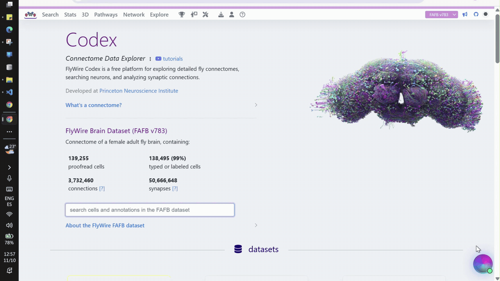
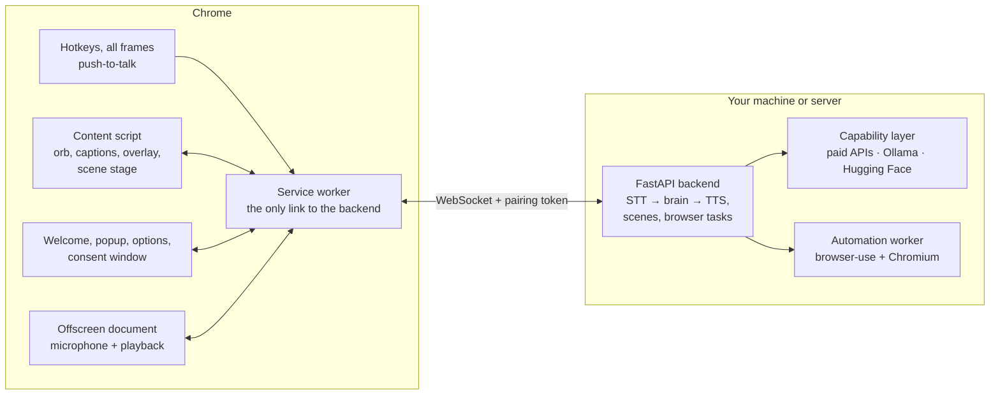

# ClickyTabs

[](https://github.com/cpohagwu/clickytabs/actions/workflows/ci.yml)
[](LICENSE)

**A voice companion that lives in your Chrome tab.** Hold a key and ask about the page you're on. ClickyTabs looks at
it, answers out loud, and points at, circles or draws over the things it's talking about while it speaks. Ask it to
show you something and it builds a 3D model, animation or diagram right in front of the page. Ask it to do something
on the site and, once you allow it, a separate browser does it with your login, checking with you before anything
that can't be undone.



It runs on your own machine. Use open models through [Ollama](https://ollama.com) with no API keys at all, or plug in
Claude, Deepgram and ElevenLabs, or mix the two. Every model is swappable.

ClickyTabs is inspired by [Clicky](https://github.com/farzaa/clicky), Farza's AI buddy that lives next to your cursor
on macOS. It's an independent implementation for Chrome, with its own architecture: an MV3 extension plus a
self-hosted Python backend.

## What it can do

- **Talk about the page.** Each question carries a screenshot and a map of the page's elements. The answer is spoken
  and captioned, and the pointer flies to "the Sign in button" as the voice says it.
- **Show things.** "Show me how a four-stroke engine works", "draw the TCP handshake", "compare these plans in a
  table": a separate code model writes a three.js, canvas, SVG or HTML scene that runs in a sandbox on a stage
  labelled *AI-generated*. Follow-ups edit it ("make it spin slower").
- **Do things.** "Add the blue mug in large to my cart." A consent window shows the task word for word and which
  site's login it would use. A [browser-use](https://github.com/browser-use/browser-use) agent then works in a fresh
  browser profile, never leaves the sites you allowed, shows each step, and asks before ordering, paying or sending.
- **Keep the conversation.** Follow-up questions continue where you left off, across tabs.
- **Fit your hardware.** From a 4 GB laptop GPU to a 24 GB card or a GPU server, with presets per hardware tier and
  per-capability overrides. See [docs/MODELS.md](docs/MODELS.md).

## Get started with Claude Code

The fastest way to get it running is with [Claude Code](https://docs.anthropic.com/en/docs/claude-code). Paste this:

```
Hi Claude.

Clone https://github.com/cpohagwu/clickytabs.git into my current directory.

Then read AGENTS.md and docs/RUNNING.md. I want to run ClickyTabs on this machine with Docker.

Look at my hardware, recommend a profile and models for it (docs/MODELS.md), then help me start it with
docker compose, load the extension in Chrome and pair it. Walk me through it.
```

It reads the docs, checks your machine and walks you through the setup. Once it's running you can keep going: build
features, fix bugs, swap models.

## Quick start

You need [Docker](https://docs.docker.com/get-docker/) (Docker Desktop on Windows and macOS) and Google Chrome 120+.
That's all: the backend, its Ollama and the extension are all built by Docker.

**1. Clone and start it**

```bash
git clone https://github.com/cpohagwu/clickytabs.git
cd clickytabs
docker compose up -d --build
```

The first build takes a few minutes. It starts the backend on `127.0.0.1:8765` with its own Ollama, and writes the
Chrome extension to `extension/dist`.

**2. Get models, or use API keys**

- **Local models (no keys):** `docker compose exec backend clicky models pull --profile local` downloads the models
  for your hardware tier (several GB, once). With an NVIDIA GPU, start with the GPU file and set your tier first:
  see [GPU and models](#gpu-and-models) below.
- **Cloud:** create `backend/.env` from `backend/.env.example`, add your keys (Anthropic for the brain, Deepgram and
  ElevenLabs for speech), run `docker compose up -d` again, and once paired pick the `cloud` or `hybrid` profile on
  the extension's options page.

**3. Load the extension**

1. Open `chrome://extensions`, turn on **Developer mode**, click **Load unpacked** and pick the `extension/dist`
   folder.
2. The welcome page opens. Paste the backend URL, `ws://127.0.0.1:8765/v1/ws`, and the token that
   `docker compose exec backend clicky token show` prints. Save.
3. Allow the microphone and choose **Allow on every visit**.

**4. Talk to it**

Open any website and **hold Right Ctrl** while you ask, then let go.

- The orb shows what it's doing: listening, thinking, speaking. Press the key again while it talks to cut it off.
- Click the orb for the panel: type a question (Enter sends), or play **Tour** to see the pointer without a backend.
- The toolbar popup shows the connection, starts a **New conversation** and has a debug text box.
- The **options page** holds models and voices (switched live), the push-to-talk key, sites where ClickyTabs stays
  off, and the sites you've allowed browser tasks on.

The microphone is only open while you hold the key.

## GPU and models

Pick a **profile** on the options page ("Models and voices"):

| Profile | Uses | Keys |
|---|---|---|
| `local` (default) | Ollama models picked for your hardware, plus Kokoro / Parakeet speech | none |
| `cloud` | Claude, Deepgram, ElevenLabs (OpenAI as fallback) | yes, in `backend/.env` |
| `hybrid` | Claude for thinking, local models for speech | Anthropic |

The `local` profile picks its models by **hardware tier**:

| Tier | For | Brain |
|---|---|---|
| `cpu` (default in Docker) | no GPU | `qwen3.5:2b` (slow: consider `hybrid`) |
| `gpu-4gb` | 3-6 GB VRAM | `qwen3.5:4b` |
| `gpu-8gb` | 6-16 GB VRAM | `qwen3.5:9b` |
| `gpu-24gb` | 16 GB+ VRAM | `qwen3.6:27b` |

**With an NVIDIA GPU** (Docker Desktop on Windows passes it through WSL 2; on Linux install the
[NVIDIA Container Toolkit](https://docs.nvidia.com/datacenter/cloud-native/container-toolkit/latest/install-guide.html)):

1. Add a line with your tier from the table above, such as `CLICKY_HARDWARE_TIER=gpu-8gb`, to `backend/.env`
   (create it from `backend/.env.example` if you haven't).
2. Start with the GPU file, then pull the models for that tier:

   ```bash
   docker compose -f compose.yaml -f compose.gpu.yaml up -d --build
   docker compose exec backend clicky models pull --profile local
   ```

The tier has to be set by hand in Docker, because the GPU belongs to the Ollama container. On a Mac, Docker can't use
the GPU: run the backend [from source](#run-from-source) with the Ollama app instead.

Any model can be replaced per capability: a bigger brain, a longer context, Ollama on another machine, a vLLM or LM
Studio server, cloud scenes with local voice. All of it is in **[docs/MODELS.md](docs/MODELS.md)**, with measured
latency and accuracy.

## Run from source

Run the backend outside Docker to develop on it, to use an Ollama you already have (with its models), to use a Mac's
GPU, or to watch the agent's browser during tasks. You need Python 3.12 with [uv](https://docs.astral.sh/uv/),
Node.js 22+ and [Ollama](https://ollama.com) 0.40.13+.

```bash
cd backend
uv sync --extra local --extra kokoro          # add --extra anthropic for Claude
uv sync --directory automation-worker         # once, for browser tasks
uv run clicky doctor                          # detects your GPU and tier; says what's missing
uv run clicky models pull --profile local     # several GB; --dry-run first
uv run clicky serve                           # ws://127.0.0.1:8765/v1/ws; `uv run clicky token show` for pairing

cd ../extension
npm ci
npm run build                                 # load extension/.output/chrome-mv3 with Load unpacked
```

Stop the Docker backend first (`docker compose down`), since both use port 8765. Developed on Windows 11; the backend
also runs on Linux (the Docker image and CI). macOS should work but hasn't been tested yet.

More: Docker details, updating, and hosting the backend on a server with TLS are in
**[docs/RUNNING.md](docs/RUNNING.md)**.

## How it works



- **Push-to-talk** records in the extension's offscreen document while the page context (a screenshot plus a
  set-of-marks map of visible elements, `e1`...`eN`) is captured in parallel.
- **The brain** streams its answer with inline tags such as `<point to="e17" label="Add to cart"/>`. The backend
  splits speech from tags, synthesizes the speech sentence by sentence, and sends each tag with the sentence it
  belongs to, so the pointer lands on the audio clock.
- **Scenes** are written by a separate codegen model and run in a sandboxed extension page: a Worker on an
  OffscreenCanvas, with no network access.
- **Browser tasks** run in a separate worker process with browser-use, seeded with the consented site's cookies,
  locked to the approved sites, and gated before irreversible clicks.
- **Security:** only the service worker talks to the backend. The backend binds to `127.0.0.1` and checks a pairing
  token, the extension's Origin and its ID.

More: [docs/ARCHITECTURE.md](docs/ARCHITECTURE.md) (design and internals), [docs/PROTOCOL.md](docs/PROTOCOL.md) (every
message), [docs/SECURITY.md](docs/SECURITY.md) (threat model).

## Project structure

```
clickytabs/
├─ backend/                 Python 3.12 (uv), package `clicky`
│  ├─ src/clicky/           api/ session/ protocol/ capabilities/ speech/ brain/ automation/
│  ├─ automation-worker/    browser-use in its own environment, driven over JSON lines
│  ├─ evals/                brain, scene and browser-task evals
│  ├─ tests/
│  └─ clicky.toml.example, .env.example, Dockerfile
├─ extension/               Chrome MV3: WXT + Svelte 5 + TypeScript
│  ├─ src/entrypoints/      background, content, hotkeys, offscreen, onboarding, popup, options, consent
│  ├─ src/lib/              protocol types (generated), socket, push-to-talk, overlay, page context, scenes, tasks
│  ├─ src/components/       orb, HUD, scene stage, task tracker
│  └─ tests/                unit (Vitest), e2e (Playwright)
├─ docs/                    ARCHITECTURE, MODELS, PROTOCOL, RUNNING, SECURITY
├─ scripts/                 ci.ps1, dev.ps1, gen-protocol.ps1
└─ compose.yaml, compose.gpu.yaml, deploy/Caddyfile
```

## Development

```bash
# terminal 1
cd backend && uv run clicky serve --reload
# terminal 2: Chrome with a persistent dev profile and live reload (pair it once)
cd extension && npm run dev
```

On Windows, `scripts/dev.ps1` starts both.

- **The wire protocol** is defined once, in Pydantic (`backend/src/clicky/protocol/`). After changing it, run
  `uv run clicky schema export` in `backend/` and `npm run gen:protocol` in `extension/` (or
  `scripts/gen-protocol.ps1`). Both test suites fail if either generated file is stale.
- **The `fake` profile** (`uv run clicky serve --profile fake`) runs every capability with deterministic stand-ins:
  no models, no keys. The tests use it.

### Tests

```bash
# backend/
uv run ruff check .
uv run pytest -q                 # hermetic: temp config home, fake providers, no network
uv run pytest -m live            # needs a running Ollama; skipped otherwise

# extension/
npm run check                    # svelte-check + tsc
npm run test                     # Vitest
npx playwright install chromium
npm run test:e2e                 # Playwright + bundled Chromium against `clicky serve --profile fake`
```

`scripts/ci.ps1` runs everything CI runs, in order (about 6 minutes; PowerShell, or `pwsh` on macOS / Linux).
GitHub Actions runs the same steps on Linux. Opt-in Playwright specs run against real models and real sites; each
describes its setup in its header.

## Troubleshooting

| Symptom | Fix |
|---|---|
| Popup says **unauthorized** | The token is wrong or was rotated. Re-pair from the popup with `uv run clicky token show`. |
| Popup says **rejected** | The backend refused the extension's ID. Load the extension from `extension/dist` (its ID is `fhgliaahcafninaodeelekpdemjkifmf`); an extension with another ID must be added to `CLICKY_ALLOWED_EXTENSION_IDS`. |
| `extension/dist` is missing or empty | `docker compose up -d --build extension`, then `docker compose logs extension` to see why. |
| The extension still behaves like an old version | After `git pull` and `docker compose up -d --build`, press the reload arrow on ClickyTabs in `chrome://extensions`. |
| Popup says **disconnected** | The backend isn't running, or not at the paired URL. Start it; the extension reconnects by itself. |
| Options page: a provider is greyed out | Its package isn't installed or its key isn't in `backend/.env`; the reason is shown. Add the extra or key and restart the backend. |
| `config show`: "missing package: anthropic" (or `kokoro_onnx`) | `uv sync --extra local --extra kokoro --extra anthropic` with the backend stopped. List every extra you use: `uv sync` removes the ones you leave out. |
| Slow answers on a small GPU | See [Tips for small GPUs](docs/MODELS.md#tips-for-small-gpus): Chrome on the integrated GPU, flash attention, a smaller context, or the `hybrid` profile. |
| The local model forgets the page | Ollama's default 4k context is too small; ClickyTabs sets `num_ctx` per model. Check `ollama ps` and `[ollama.runner."<model>"]` in `clicky.toml`. |
| The mic stops working after closing the welcome page | The permission was "Allow this time". Click **Pairing & mic** in the popup and choose **Allow on every visit**. |
| No orb on a page | Extensions can't run on `chrome://` pages, the Web Store, the PDF viewer or the New Tab page. |
| Cloud answers have captions but no voice (ElevenLabs **402**) | Free ElevenLabs accounts can only use default voices through the API. Pick one on the options page. |
| "Browser tasks need the automation worker" | `uv sync --directory automation-worker` in `backend/`, once. |
| The agent starts signed out | Some sites tie a login to the browser or device (Google, for one) and reject copied cookies. Do that step yourself. |
| "Could not build this scene" | The scene code failed twice or took too long. Ask again more simply; small local models do best with simple scenes. |
| `docker compose up`: port 8765 in use | Another backend is running. Stop it, or set `CLICKY_PORT=18765` and pair with that port. |

## Known limitations

- Chrome only; the page context covers the top document, not iframes.
- On a 4 GB GPU, spoken answers start about 7 seconds after you let go of the key; the cloud profile takes 2-5 seconds.
- Small local models point less reliably and are experimental as browser agents.
- Conversations live in the backend's memory and are forgotten when it restarts.
- More in [docs/ARCHITECTURE.md](docs/ARCHITECTURE.md#known-limitations).

## Contributing

Issues and pull requests are welcome; start with [CONTRIBUTING.md](CONTRIBUTING.md). If you use Claude Code or
another coding agent, point it at [AGENTS.md](AGENTS.md): it describes the codebase and the conventions.

Please report security problems privately: see [docs/SECURITY.md](docs/SECURITY.md).

## Acknowledgements

- [Clicky](https://github.com/farzaa/clicky) by Farza, the idea this project grew from.
- [browser-use](https://github.com/browser-use/browser-use), [Ollama](https://ollama.com),
  [WXT](https://wxt.dev), [Svelte](https://svelte.dev), [three.js](https://threejs.org),
  [FastAPI](https://fastapi.tiangolo.com), [kokoro-onnx](https://github.com/thewh1teagle/kokoro-onnx),
  [onnx-asr](https://github.com/istupakov/onnx-asr) and [faster-whisper](https://github.com/SYSTRAN/faster-whisper).
- The open models: Qwen, Gemma, Ministral, LFM, Kokoro, Parakeet and Whisper.

## License

[MIT](LICENSE). Models you download have their own licenses: see [docs/MODELS.md](docs/MODELS.md#licenses).
