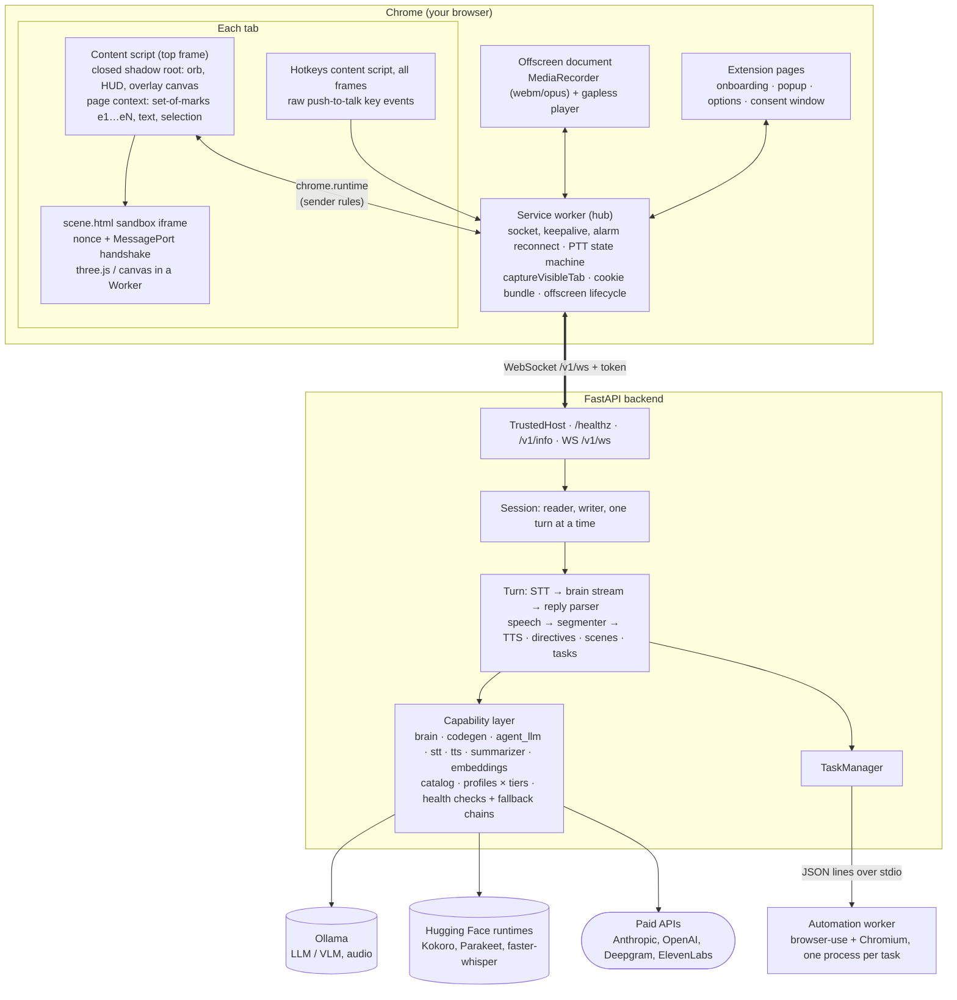
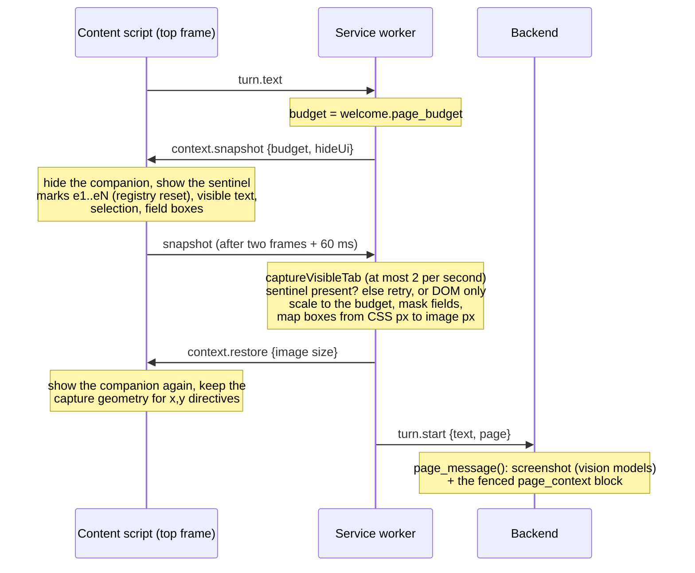
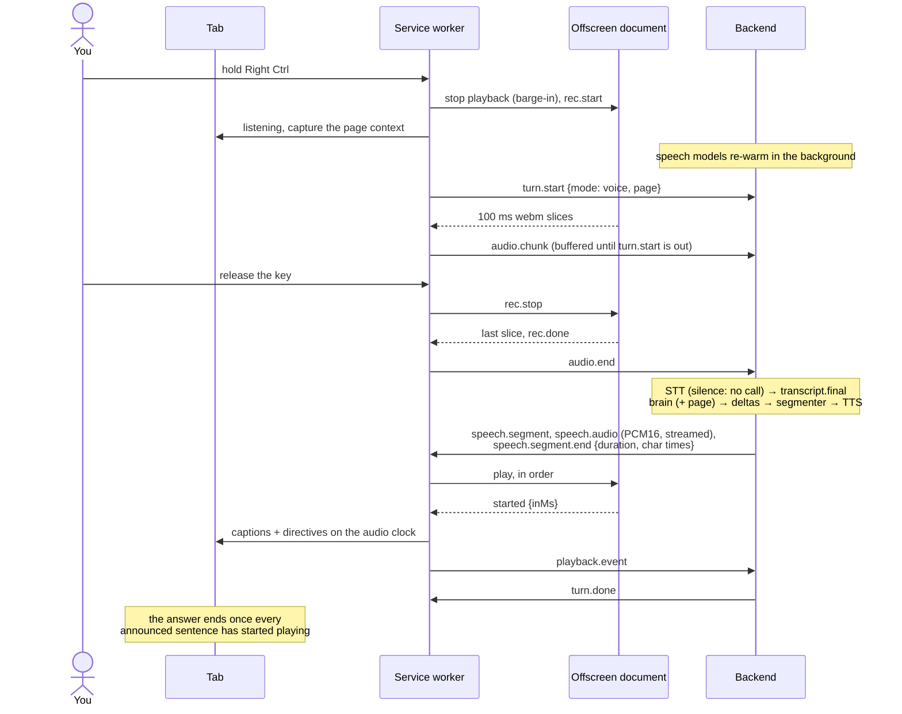
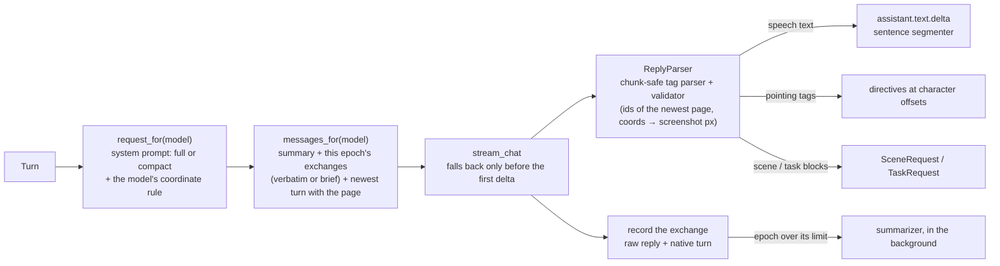
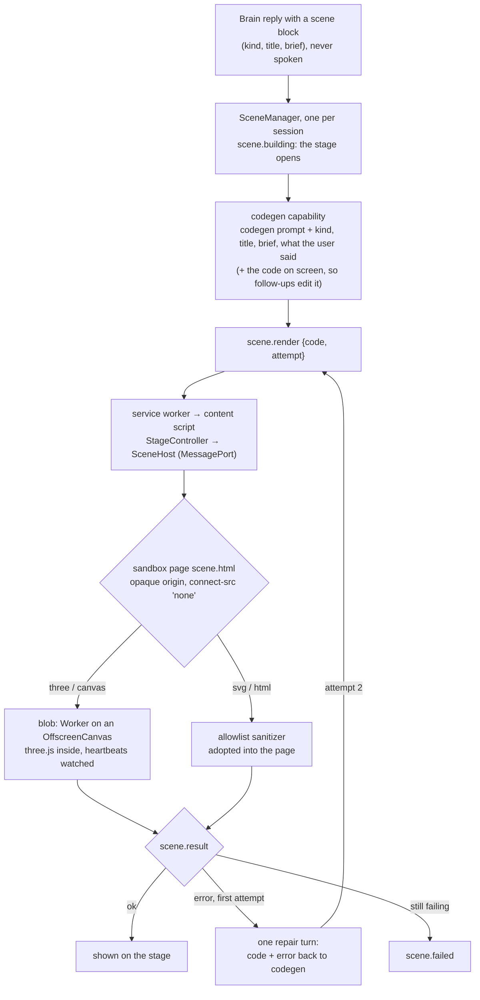
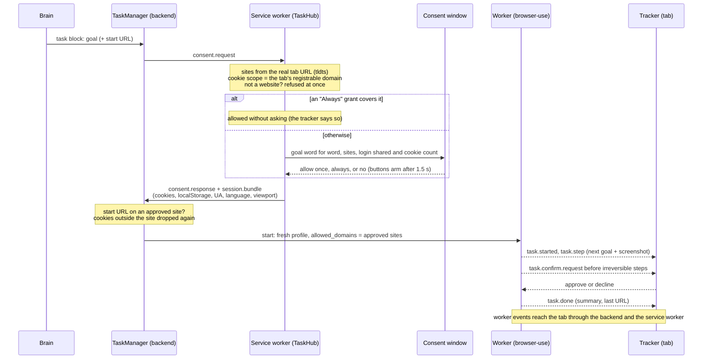

# Architecture

ClickyTabs has two halves:

- a **Chrome MV3 extension** (`extension/`): UI, overlay, microphone and speaker, screenshot and DOM capture, cookie
  export;
- a **self-hosted FastAPI orchestrator** (`backend/`, package `clicky`): speech-to-text, the brain, text-to-speech,
  visuals and browser automation.

They talk over one authenticated WebSocket (`/v1/ws`). The wire protocol is documented in [PROTOCOL.md](PROTOCOL.md);
the security model in [SECURITY.md](SECURITY.md); model choices in [MODELS.md](MODELS.md).

## Component diagram



## Key decisions

| Area | Decision | Why |
|---|---|---|
| Backend link | One WebSocket in the **service worker**; app `ping` every 20 s; single in-flight `connect()`; backoff ≤ 25 s **plus a `chrome.alarms` reconnect (30 s) while disconnected**; close 4401 → terminal `unauthorized` until re-paired; state in `chrome.storage.session` (`conn`) | SWs die about 30 s after the last event, so timers alone can't reconnect; content-script requests run as the page origin (SOP, page CSP, the Local Network Access prompt in Chrome 142+); `chrome-extension://` counts as loopback, so SW → 127.0.0.1 isn't gated |
| Secrets in the extension | `chrome.storage.local.setAccessLevel('TRUSTED_CONTEXTS')` at SW start; token, backend URL and consent grants live there; content scripts get data only via SW messages; sender rules; backend URL must be `ws(s)://`, default `ws://127.0.0.1:8765/v1/ws`; the token is never sent over non-loopback `ws://` | By default content scripts can read and write `storage.local`, so a buggy or compromised content script could leak the token or redirect the backend |
| Stable extension ID | A committed dev **public key** (`manifest.key`), so dev, prod and e2e share one ID | The backend ID allow-list, mic grant, pairing and e2e all depend on it |
| Mic + speaker | **Offscreen document** created once with `['USER_MEDIA','AUDIO_PLAYBACK']`, `ensureOffscreen()` before each use; mic granted on the onboarding page (extension origin); on `NotAllowedError` → `mic: needs-grant` → reopen `onboarding.html#mic` | Offscreen documents can't show a permission prompt; "Allow this time" grants lapse when the tab closes |
| Push-to-talk | Default **hold Right Ctrl** (modifier-only; 200 ms arm; cancelled by another key or Ctrl+click), configurable; `toggle-listen` command as fallback; hotkey script in all frames incl. about:blank/srcdoc; **the SW owns PTT state** with release on keyup/blur/hidden/pagehide/tab switch/window blur and a 60 s max hold; Orb + `REC` badge while recording | A modifier-only chord collides with nothing on the page; a lost keyup must never leave the mic open |
| Injected UI | WXT `createShadowRootUi` (closed root, host `<clickytabs-ui>`, `isolateEvents` for keys) + full-viewport `pointer-events:none` canvas; `popover="manual"` on an element *inside* the root, re-promoted on `toggle`/`fullscreenchange`; CSS custom properties prefixed `--cc-` | Style isolation; WXT's `:host{all:initial}` would fight a popover on the host itself |
| 3D/diagram scenes | **Sandboxed page** `scene.html` (static, classic IIFE harness, Three.js bundled); web-accessible with `use_dynamic_url`; iframe created on demand inside the shadow root (`sandbox="allow-scripts"`, random `#nonce`); handshake: one `init{nonce}` + transferred `MessagePort`, then port-only, with `event.source` checks; CSP blocks fetch/XHR/WebSocket | The only MV3 context that allows `eval`; classic scripts avoid module-CORS on opaque origins; the handshake stops other pages from driving an embedded sandbox |
| Pointing | **Inline directives** in the spoken stream; element IDs (`to="e17"`) primary, pixel coordinates fallback | Scroll-proof and model-agnostic |
| Actions + consent | Inline `<task …>goal</task>` → **consent in an extension popup window** (`isTrusted` + arming delay) → browser-use **worker process**. Cookie scope comes from the current tab's registrable domain, never the model; cross-site requests always ask and can't be "Always" | In-page consent can be clickjacked; page text can prompt-inject a model into asking for another site's session |
| Model-agnostic core | **Capability layer**: typed interfaces, a provider **catalog** (kind `paid`/`open`, source `api`/`ollama`/`huggingface`), **profiles** (`local`/`cloud`/`hybrid`/`fake`) × hardware tiers, **atomic per-profile overrides**, **fallback chains with health checks** (fall back only before the first delta/byte), typed per-adapter options (`extra='forbid'`) | Swap any model per task; a test enforces "≥ 1 paid + ≥ 1 open provider per capability" |
| Chat contract | `stream()` yields `TextDelta` and `Finish(stop_reason, refusal_category, usage, native_turn)`; `ModelInfo` says how the model points (`coord_space`), which prompt it gets and how history is replayed (`verbatim` for Claude: append-only, page context kept in the turns that carried it, native turns replayed; `compact` for local models: brief text turns, page context only in the newest); epoch summaries trim both | Preserved thinking breaks if earlier turns are edited; small context windows can't hold old screenshots; refusals and usage must be visible |
| Ollama usage | REST over `httpx`; `think`/`keep_alive` are top-level request fields; **runner options (`num_ctx`, `num_batch`, `num_gpu`, `num_thread`) defined once per model** and shared by every role; brain warmed at startup; one active turn per session | Different runner options make Ollama reload the model; misplaced keys are silently ignored |
| Paid LLM | `claude-opus-5-5` via `anthropic` 2.x: streaming, `output_config.effort` (low for voice), prompt caching, `fallbacks:"default"`, never sampling params | Thinking is always on, so effort is the latency knob |
| Automation worker | Separate uv project (browser-use 0.13.14 and its pins), JSON lines over stdio: `Popen` + reader threads, `PYTHONUTF8=1`, stdout guard, stderr drained to a log, **Windows Job Object (kill-on-close)**, secrets via the child environment; IPC models defined once in the backend | Dependency, crash and cookie isolation; uvicorn `--reload` on Windows uses a SelectorEventLoop that can't spawn asyncio subprocesses |
| Backend hardening | `TrustedHostMiddleware` (DNS rebinding); minimal `/v1/info`; capability details only in the authenticated `welcome`; redaction filter on root + uvicorn log handlers; one **`CLICKY_HOME`** for `.env`, `clicky.toml` and the token | Hermetic tests; one token regardless of the working directory |
| Tooling | WXT 0.21.5 + Svelte 5 + TypeScript ~6.0, Vite, web-ext (persistent dev profile), npm | First-class MV3 entrypoints |
| Protocol | Pydantic v2 discriminated unions → committed `protocol.schema.json` → `json-schema-to-typescript` → `protocol.gen.ts` (drift gate in both test suites) | Backend and extension can't drift |

## Backend internals

- **Configuration** (`clicky/config.py`). Resolution order, highest first: init kwargs > `CLICKY_*` environment >
  `CLICKY_HOME/.env` > `CLICKY_HOME/clicky.toml`. `profiles` and `ollama` come only from `clicky.toml`, so an
  environment variable can never half-merge a provider choice. `CLICKY_HOME` defaults to `backend/` when running from
  source, else `%LOCALAPPDATA%\ClickyTabs`.
- **App factory** (`clicky/main.py`). The lifespan configures redacting logs, resolves the token (created once
  under `CLICKY_HOME/.clicky/auth_token`), builds health-checked capability chains, and warms the brain model in the
  background. `clicky serve` passes CLI flags to the factory through `CLICKY_HOST`, `CLICKY_PORT` and
  `CLICKY_PROFILE`, because uvicorn's `factory=True` calls `create_app()` without arguments.
- **Session** (`clicky/session/`). One reader task, one writer task and at most one turn task per connection.
  The turn task converts every exception into `error` + `turn.done`. Provider streams are consumed with
  `contextlib.aclosing()`, so `turn.cancel` closes the upstream HTTP request immediately.
- **Capability layer** (`clicky/capabilities/`). `kinds.py` holds import-free enums; `base.py` the
  Protocols (`ChatModel`, `STTEngine`, `TTSEngine`, `Embedder`, `AgentLLM`); `catalog.py` one row per provider, read
  without importing heavy dependencies. See [MODELS.md](MODELS.md).

## Companion UI and overlay

Everything lives in one closed shadow root (`<clickytabs-ui>`, WXT `createShadowRootUi`):

```
<clickytabs-ui>  :host { all: initial !important }  (beats the page's !important rules on the host)
 └ div.cc-layer  popover="manual", full viewport, pointer-events: none
    ├ canvas.cc-overlay   OverlayRenderer: flights, marks, arrows, paths, spots, labels
    ├ div.cc-bubble       caption while the HUD is closed
    ├ div.cc-hud-anchor   Hud.svelte (beside the orb when docked, bottom-right when following)
    ├ div.cc-orb-anchor   translate3d from a Svelte Spring; button > Orb.svelte
    └ div.cc-scene-slot   scene sandbox iframe (the stage)
```

- **Top layer.** The layer is a manual popover, re-shown after every page `toggle` event (dialogs, popovers) and
  `fullscreenchange`, so it stays above things the page opens later. Re-showing restores focus to the HUD input.
  Ancestor transforms and filters can't touch it.
- **Isolation.** The closed root keeps page selectors out; WXT's `:host{all:initial !important}` resets inherited
  styles and wins over page `!important` rules aimed at the host. Inline positions are set through CSSOM (`style:`
  directives), never `style="…"` strings. Keys are isolated by WXT; pointer and mouse events stop at the shadow root,
  so the page's "click outside" handlers don't fire on the orb.
- **Trusted Types.** `lib/trusted-types-guard.ts` is the content script's first import. Svelte creates a policy
  (`svelte-trusted-html`) when it loads; on pages that allow-list policy names that throws. The guard probes once and,
  if policies are forbidden, hides `trustedTypes` from the extension's isolated world only (sink enforcement doesn't
  apply there; the page's own factory is untouched).
- **Controller** (`lib/companion-controller.ts`). Owns the page side of a turn: `turn.text` → the worker starts a
  turn tagged with the tab and routes its events back (`turn.event`); deltas become captions, `visual.directive`
  events go to the directive applier, `turn.done` ends it. One turn per tab (a new question replaces the old one);
  Stop sends `turn.stop`. The store keeps the worker-owned orb state (`listening`) separate from the page's own
  activity, and the worker's state wins while active.
- **Directives** (`lib/overlay/directives.ts`). Element refs are registry ids (`e17`; the page's set-of-marks fills the
  registry), or `x,y` screenshot pixels mapped back to the page by `mapPoint`. Points smooth-scroll off-screen targets into
  view first. `scheduler.ts` turns `at_char` offsets into delays (`start + duration × at_char/len`, or exact character
  times from TTS alignment).
- **Renderer** (`lib/overlay/renderer.ts`). One canvas; a rAF loop runs only while shapes exist and re-reads every
  target rect each frame (scroll, resize and layout changes are tracked for free). Text containers are measured by
  the box of their text (a `Range`), so a block heading isn't circled across the whole page. Marks last 14 s, landing
  spots 4.5 s; label pills step clear of each other.
- **Debug probe.** `debug.state` reports the orb's rect, what a click at its center would hit (`orb`, `companion`,
  `page`), whether the layer is in the top layer and the canvas size. The shadow root is closed, so e2e tests rely on
  it plus screenshot pixel checks.

## Page context

A HUD turn carries what the brain needs to answer about the page:



- **Budget.** `brain/budget.py` picks `COMPACT` (local models) or `FULL` (API models) and turns the screenshot off for
  models without vision. Worst-case pages stay under 3k / 8k text tokens (tested).
- **Marks.** Candidates come from native queries per priority group (headings, controls, links, media, landmarks)
  over the document and every open shadow root; images and controls inside a link or button belong to it. Then, in
  priority order until the budget is full: `checkVisibility` and a hit test at the visible centre (covered elements
  drop out). Hit tests are time-boxed (8 ms); the text walk too (6 ms). Ids follow reading order.
- **Names.** ARIA (`aria-labelledby`, `aria-label`), then labels / placeholder for fields (never their values), alt
  text for images, visible text otherwise, and the contained image or icon label for image-only links and buttons.
- **Coordinates.** Boxes are clipped to the viewport and scaled by `image width / CSS viewport width`, independent of
  devicePixelRatio and zoom. `imageToPage` maps the brain's pixels back at the capture's scroll position.
- **The brain's message.** `brain/context.py` renders URL, title, viewport, screenshot size, selection, one line per
  mark (`e2 button "Add to cart" (disabled) [16,91,120,32]`) and the visible text inside `<page_context>…</page_context>`,
  with anything that could close the fence defanged, followed by a note that the block is untrusted data. How earlier
  turns' page context is replayed depends on the model (see [Brain](#brain)).

## Voice turn



- **Ordering.** Every command to the offscreen document goes through one queue (a quick tap's `rec.stop` cannot
  overtake its `rec.start`; audio chunks keep their order); the recorder emits `rec.done` only after its last slice.
- **Streaming speech.** Every TTS adapter yields PCM16, so the first sentence plays while it is still being
  synthesised. The player starts a sentence once `buffered ≥ total × (1 - arrival rate) + 200 ms` (gapless; a slow
  synthesiser makes it start later instead of stuttering) and the next one exactly where it ends.
- **Captions and pointers follow the audio.** Text deltas only fill a fallback; the caption reveals each sentence word
  by word from its `started` event (`inMs` ahead), and directives fire at `start + duration × at_char / len` (exact
  character times when the TTS reports alignment). A turn ends when playback is idle and `turn.done` has arrived.
- **Fallbacks.** STT replays the buffered recording to the next healthy member; TTS falls back only before a
  sentence's first audio; if TTS fails mid-answer the captions carry on silently (`tts_unavailable`).
- **Latency.** `turn.done.metrics` carries `stt_ms`, `brain_first_token_ms`, `first_audio_ms` and `total_ms` from key
  release; the SW records release → audible (`debug.voice`). Measured numbers are in [MODELS.md](MODELS.md#measured-results).

**Text turns** skip STT and TTS: the popup's debug text box and the HUD's text box send `turn.start {mode: "text"}`
and render `assistant.text.delta` events as captions; their directives arrive as `visual.directive` events and apply
at once.

## Brain



- **Conversations** (`brain/history.py`). One per browser session, stored in the backend's `ConversationStore` (32,
  most recent) and resumed by id: the extension keeps it in `chrome.storage.session` and sends it in `hello`, so a
  reconnect or a service-worker restart continues the conversation; the popup's "New conversation" sends
  `conversation.reset`. A conversation idle for 20 minutes starts afresh. A backend restart forgets them.
- **Replay per model.** Claude (`verbatim`) gets every earlier user turn byte-identical to what was sent - screenshot
  and page block included - and its own native assistant turns with their thinking blocks; nothing earlier is ever
  edited, so its prompt cache and preserved thinking hold. Local models (`compact`) get earlier turns as
  `(earlier turn, on the page "…")\nUser: …` plus the reply, and the page only in the newest turn, which keeps the
  request inside a small context window and the prefix stable for Ollama's KV cache. Native turns are replayed only
  to the provider that produced them.
- **Epochs.** When an epoch passes its limit (Claude 12 exchanges / ~64k tokens; local 6 / ~2.5k), the summarizer
  capability condenses it in the background; the next turn waits up to 3 s for it and then starts the new epoch from
  the summary alone (nothing older is replayed). Exchanges recorded meanwhile survive as text. A failing summarizer
  falls back to the tail of the transcript.
- **What is recorded.** Answers (with their native turn) and replies cut off by barge-in or a failure (as plain text,
  so the history matches what the user heard). Refusals and errors are not recorded.
- **Directive timing in voice turns.** A directive is marked in the sentence segmenter where it was written; the
  sentence carries it (`speech.segment.directives`, `at_char` inside that sentence). Tags after the last word attach to
  the last sentence if its header hasn't gone out, else fire at once; with no voice (TTS failed) they fire at once.
- **Missing words.** When a model writes a tag *instead of* the thing's name ("Click <point label="Close"/>."), the
  reply parser speaks the label (it holds ~24 characters after a labelled tag to decide).
- **Pre-warm.** At startup the brain's system prompt is pre-filled (Ollama: evaluated into the KV cache; Claude:
  written to the prompt cache with a `max_tokens: 0` request); push-to-talk re-warms Claude's cache when no request
  touched it for 4.5 minutes. Ollama is never re-warmed on push-to-talk (that would replace the conversation's cached
  prefix).

## Directive grammar

Directives are plain-text tags embedded in the model's spoken stream. Any model can emit them; the parser is
chunk-safe and directives are never spoken. The system prompts (`brain/prompts/full.md`, `compact.md`) teach them;
compact (small local models) teaches only `point` and `mark`, with few-shot examples.

| Tag | Meaning |
|---|---|
| `<point to="e17" label="Add to cart"/>` | Fly the pointer to element mark `e17` |
| `<point x="812" y="430" label="peak"/>` | Point at screenshot pixel coordinates (converted per the model's coordinate convention) |
| `<mark to="e17" style="circle\|box\|underline\|glow"/>` | Highlight an element |
| `<arrow from="e3" to="e17"/>` | Arrow between elements (wire fields `source` / `target`) |
| `<path points="x,y …"/>` | Freehand path in screenshot pixels |
| `<scroll to="e42"/>` | Scroll an element into view |
| `<clear/>` | Remove all annotations |
| `<scene kind="three\|canvas\|svg\|html" title="…">brief</scene>` | Ask the codegen model for a scene (see below) |
| `<task start_url="…" session="yes\|no">goal</task>` | Propose a browser task (consent required) |

Small local models get a compact prompt with few-shot examples. The wire form of each directive is in
[PROTOCOL.md](PROTOCOL.md#directives).

## Scenes



- **Why a separate codegen model.** The brain writes a brief, never code: its prompt stays short and cacheable, its
  effort stays low for the voice, and the speech isn't held up behind a long code block. The codegen capability has
  its own chain (cloud: `claude-opus-5-5` at effort medium; local: the brain's own `qwen3.5:4b`, so no reload) and
  prompt variant (full for API and big models, compact with three short examples for small ones).
- **Runtime API.** three: `THREE`, `scene` (transparent background, hemisphere + key light), `camera` (fov 50 at
  6,4,8), `renderer`, `controls` (OrbitControls with damping, driven through an element proxy), `onFrame(dt, t)`,
  `addLabel(text, position)` (camera-facing sprite), `width`, `height`. canvas: `canvas`, `g` (2D context in CSS
  pixels), `onFrame`, `pointer`, `width`, `height` (a fixed logical size; stage resizes scale it). Every name is also
  on `ctx`.
- **Web-page habits** (`lib/scene/compat.ts`; small models write scenes like pages). The code runs in an inner async
  function, so `const g = canvas.getContext('2d')` or `const scene = new THREE.Scene()` shadows the API instead of
  failing; a SyntaxError is retried once with fences, curly quotes and prose cleaned up; a never-called `run()` /
  `main()` / `init()` is called; `window` and `document` are inert stand-ins (sizes, resize/load events, canvases);
  `THREE.WebGLRenderer` returns the runtime's renderer, a Scene or camera the code makes itself is adopted when the
  provided one stays empty, and missing addons (`TextGeometry`, loaders) fail with a hint (`use addLabel`). For 2D
  scenes `ctx` also works as the drawing context.
- **What "rendered" means.** The code finished within 10 s, 20 frames ran without an error, and something visible was
  drawn: three counts meshes/lines/points and reads back the frame (objects all outside the camera fail as blank);
  canvas checks for painted pixels; svg/html check for a non-empty box. Errors carry the line inside the scene code
  (`TypeError: cube.spin is not a function (line 4: cube.spin();)`), which is what the repair prompt gets.
- **Containment.** The Worker has no DOM, so scene code can't navigate the sandbox frame or draw outside its canvas;
  the inherited CSP blocks fetch, XHR and WebSockets. A Worker that stops sending heartbeats for 4 s while visible
  (an endless loop) is terminated. Runtime messages carry a random token the scene code never sees, so it can't
  report its own success. svg/html markup is allowlisted: no scripts, handlers, links, forms, frames, meta/base,
  foreignObject or outside references (fragment `#id` references and `data:` images stay).
- **Stage.** `ScenePanel.svelte`: a glass panel in front of the page, labelled "AI-generated", with the title and a
  status line; drag the header to move it, the corner to resize, pin it to the side, close it (Esc). Closing it while
  a scene is still being written turns that scene down (no repair). It hides with the rest of the companion during
  screenshot capture; the next turn's page context names the open scene instead.
- **One job per session.** A new scene replaces the one being built; "New conversation" cancels it. The code of the
  last 8 shown scenes is kept for follow-up edits.

## Browser tasks



- **Who decides what.** The model writes the goal and, at most, a start URL. Everything that grants access is
  decided outside it: the extension works out the sites from the tab Chrome reports, the user approves them in a
  window the page can't reach, and the backend rejects a start URL off those sites and drops cookies outside the
  tab's site. The agent's browser can only navigate to the approved sites.
- **Agent model.** The `agent_llm` capability (cloud: `claude-opus-5-5`, effort low per step, adaptive thinking -
  Opus 5.5 can't disable it, and browser-use then uses `tool_choice: auto`, which Opus 5.5 requires; local:
  `qwen3.5:4b` in flash mode, DOM only, experimental). browser-use's judge is off (an extra model call per task).
- **Asking first, enforced.** The agent's system prompt tells it to call `ask_user` before orders, payments,
  bookings, sending, deleting, account changes or accepting terms - and Claude does. Small local models don't reliably do
  so, so the worker also **gates every click in code**
  (`clicky_worker/guard.py`): if the clicked element's label reads like an irreversible action, the user is asked
  in the tracker before the click happens ("Click “Place order” on shop.test?"); an approved `ask_user` covers one
  such click, so Claude isn't asked twice. Coordinate clicking stays off (a click must name an element) and the
  `evaluate` action is removed (page JavaScript could click past the gate). Enter is gated too: `send_keys` with Enter and typed text with a line break ask first when the field's form has a
  submit button labelled like an irreversible action, or when the field is a message box outside a form. Questions wait up to 2 minutes; no answer is "no". Stop works
  at any time, including while the consent window is open.
- **Narration** is the agent's own "next goal" text per step, not extra model calls. The result appears in the
  tracker; it is not spoken.
- **Headed or headless.** The agent's browser is headed by default (you can watch it), `automation_headless = true`
  for tests and servers. The browser is whatever browser-use finds (Chrome first; `automation_browser` to pick one).

## Runtime configuration, recovery and packaging

- **Runtime configuration.** The options page asks the service worker for `config.get` / `config.set`, which it
  relays over the socket. `ConfigService` (session/config_service.py) answers with every capability's active provider,
  health and chain, the providers it could switch to (installed? key set?), local Ollama models and the TTS voices
  (`voices()` on Kokoro, OpenAI, ElevenLabs and the fake TTS). A change is validated against the catalog and the
  adapter's options model, applied by `Capabilities.reconfigure()` (unchanged chains keep their providers and loaded
  models; replaced providers close 10 minutes later, so a turn using them can finish), then saved to
  `.clicky/ui-settings.json` and pushed to every session (the page budget follows the brain). Only provider, model,
  voice, effort and speed can be set this way; `CLICKY_PROFILE` pins the profile.
- **Token rotation** takes effect on a running backend: `TokenStore` re-reads the token file when it changes, and a
  2 s watcher redacts the new token and closes every session with 4401.
- **Recovery from MV3 lifetimes.** The offscreen document holds a lifeline port to the worker. If the worker stops,
  the document drops the recording and playback and reconnects, which starts a new worker that reconnects to the
  backend and broadcasts `worker.started`: tabs end a turn in flight with a message and mark a running task stopped.
  If the document stops, the worker ends the voice turn it was recording or speaking. The 30 s alarm runs while
  connected too, so a stopped worker comes back without user action. `resilience.spec.ts` stops the worker and the
  document mid-turn.
- **Packaging.** `compose.yaml` builds and runs three services:
  - the backend image: python 3.12 slim, both uv environments, headless Chromium, non-root, a `/data` volume;
  - Ollama, with no published port, on the CPU by default (`compose.gpu.yaml` adds the NVIDIA GPU);
  - a one-off Node build of the extension, copied to `extension/dist` for **Load unpacked**.

  The `remote` profile adds Caddy for TLS. The product name, ClickyTabs, lives in one constant (`src/lib/brand.ts`).

## Testing

- **The fake profile.** Every capability has a deterministic `fake` provider, so the backend runs with no models and
  no keys. The fake brain reacts to markers in the question or the page text (`[point]`, `[scene:svg|Title]`,
  `[task]`, `[page]`, `[history]`; see `capabilities/fake.py`), and the fake microphone always says the same sentence,
  so end-to-end tests can drive every feature deterministically.
- **Journeys.** `extension/tests/e2e/journeys.spec.ts` runs the three things ClickyTabs is for, by voice:
  - pairing on the welcome page, then a spoken question answered aloud with the pointer on the named element;
  - a spoken request that ends with a scene on the stage;
  - a spoken request that goes through consent, the scripted agent's steps and its question, to the result.

  Other specs cover a hostile fixture page (CSS resets, strict CSP, Trusted Types, dialogs, fullscreen), page
  context at several device pixel ratios, scenes, browser tasks, and recovery when Chrome stops the service worker or
  the offscreen document mid-turn (`resilience.spec.ts`). Opt-in specs run against real models and real sites.
- **CI.** `scripts/ci.ps1` runs every check in order: backend lint, tests, protocol schema and lock files; extension
  types, unit tests, build, manifest, store package and the Playwright suite. `.github/workflows/ci.yml` runs the
  same on Linux.
- **Latency timeline.** With the developer option on (options page), the HUD shows where the last answer's time went:
  - voice turns count from the key release, using the backend's `turn.done.metrics` (transcript, first words, audio
    sent, done) plus the moment the page heard the first audio;
  - typed turns count from Enter (first words, done).

  `lib/timeline.ts` builds it.

## Known limitations

- A page's modal `<dialog>` and element fullscreen make everything outside them inert, including the companion. It is
  re-promoted above both and keeps painting (overlay, captions, orb), but clicks don't reach the orb or the HUD.
  Push-to-talk keeps working (it's keyboard-driven). Re-parenting the host into the page's fullscreen element would
  lift this but risks breaking page frameworks; not done.
- Follow mode ignores the pointer by design; open the HUD from dock mode (switch in the popup, options or the HUD).
- The overlay draws on the top document only; elements inside cross-origin iframes can't be targeted (page context
  is top-frame only).
- The demo picks elements with simple heuristics (first visible heading, action, prose paragraph, image). It skips a
  step when nothing fits.
- The screenshot needs the turn's tab to be the visible tab of its window (`captureVisibleTab`); otherwise the turn
  goes DOM-only. During the capture (about 0.2 s) the companion blinks out and a 16 px colour square shows in the
  top-left corner.
- Page context covers the top document and open shadow roots; iframes (including same-origin ones) and closed shadow
  roots are not read.
- Conversations live in the backend's memory: restarting the backend forgets them (the extension then starts a new
  one under the same id).
- On a 4 GB GPU the brain runs mostly on the CPU, so spoken answers start ~7 s after the key is released (measured
  p50 with Kokoro TTS; 11.5 s with lfm3 TTS, whose speech is slower than real time while the brain decodes). Most
  of it is the brain's first token (~3.5 s after the transcript): every turn prefills the new screenshot and page.
- In the cloud profile the default brain (`claude-opus-5-5`) answers in 5.2 s p50 from key release, with a long
  tail; `claude-haiku-5-5` gets 2.4 s (MODELS.md).
- Small local models point less reliably (15-16 of 20 eval pages) and sometimes say less than they point at.
- Browser tasks need a website tab: not on `chrome://` pages, IP addresses or `localhost` (no registrable domain).
  One task per session at a time. Cookies the agent's browser gets are not copied back into yours (the tracker says
  so); what it changes on the site's server is visible in your tab.
- Sites that bind sessions to a device or browser (Device Bound Session Credentials, some IP / user-agent checks,
  Google first) may not accept the copied login; the agent then starts signed out and says so in its summary.
- The task result is shown in the tracker, not spoken. Small local agent models are experimental (MODELS.md).
- Scenes take a while: the codegen model writes 100-200 lines (cloud ~20-40 s; local much longer, see MODELS.md).
  The stage shows the time spent. Scenes are only built for turns from a tab, not the popup's debug box.
- A scene still being written is lost when the extension's connection to the backend drops (service-worker or
  backend restart): the backend cancels a session's scene job with the session, and the stage says so at once.
- Scene code runs in the Worker with three.js and nothing else: no loaders, textures from files, fonts or models;
  labels are sprites drawn with the system font. Animation stops while the tab is hidden.
- Typed HUD questions are answered in text only; only push-to-talk answers are spoken.
- The microphone indicator shows while the key is held; Chrome may close the offscreen document after ~30 s of
  silence, which costs the next turn ~100 ms to reopen it.
- Content scripts don't run on `chrome://` pages, the Chrome Web Store, the PDF viewer or the New Tab page; the
  `toggle-listen` command still works there.
- MV3 can stop the service worker and the offscreen document at any time. A turn, recording or task in flight then
  ends with a message (it can't be resumed: the backend session closed with the worker's socket); the next one works. Without an offscreen document to wake it, a stopped worker comes back on the next message or within 30 s.
- Runtime switching covers the profile and one provider per capability (model, voice); fallback chains, hosts, base
  URLs and runner options are still edited in `clicky.toml`. Embeddings are not used yet.
