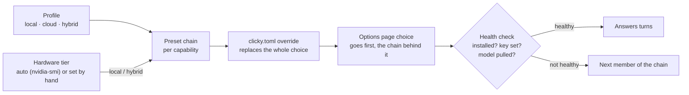

# Models and hardware

ClickyTabs is model-agnostic. It needs seven capabilities, and each one can come from a paid API or from an open
model on your own machine:

| Capability | What it does |
|---|---|
| `brain` | Reads the page (screenshot + element list), answers, and decides where to point |
| `codegen` | Writes the 3D / 2D / SVG / HTML scenes the brain asks for |
| `agent_llm` | Drives the browser agent during a browser task |
| `stt` | Speech-to-text, including endpointing (finding where you spoke) |
| `tts` | Text-to-speech |
| `summarizer` | Condenses long conversations between turns |
| `embeddings` | Reserved for an optional memory feature; nothing uses it yet |

A **profile** picks a provider for each one:

| Profile | What it uses | Keys needed |
|---|---|---|
| `local` (default) | Open models: Ollama first, Hugging Face runtimes as fallbacks | none |
| `cloud` | Claude (Anthropic), Deepgram, ElevenLabs, OpenAI as fallback | yes |
| `hybrid` | Claude for brain, codegen, agent and summaries; open models for speech | Anthropic |
| `fake` | Deterministic stand-ins, for tests and development | none |

The `local` profile then picks models for your **hardware tier**. This page explains how to find the right setup for
your machine, how to change any model, and what to expect.

## Quick picks

| Your machine | Start with | Notes |
|---|---|---|
| No GPU, or integrated graphics | `hybrid` or `cloud` | `local` works on the `cpu` tier, but answers take tens of seconds |
| NVIDIA, 4-6 GB VRAM | `local` (tier `gpu-4gb`) | Spoken answers start ~7 s after you let go of the key; `hybrid` is ~2-5 s |
| NVIDIA, 8-12 GB VRAM | `local` (tier `gpu-8gb`) | A 9B brain on the GPU; speech on the GPU too |
| NVIDIA, 16-24 GB+ VRAM | `local` (tier `gpu-24gb`) | A 27B brain; a 35B-A3B agent model |
| Apple Silicon | `local`, tier set by hand | 8 GB: `gpu-4gb`, 16-24 GB: `gpu-8gb`, 32 GB+: `gpu-24gb` (see [below](#apple-silicon-amd-and-other-gpus)) |
| AMD or Intel GPU | `local`, tier set by hand | Pick the tier by VRAM, if your Ollama build uses the GPU |
| A separate GPU server | `local`, Ollama on that server | Point `[ollama] host` at it ([recipe](#use-ollama-on-another-machine)) |
| vLLM, LM Studio, llama.cpp server | `openai_compat` provider | Any OpenAI-compatible endpoint ([recipe](#use-an-openai-compatible-server)) |

Whatever you choose, `uv run clicky doctor` shows what it detected and which models the profile needs, and
`uv run clicky config show` shows the provider chain each capability ended up with, and whether it is healthy.

## Hardware tiers

`hardware_tier = "auto"` (the default) reads the NVIDIA GPU's memory with `nvidia-smi`:

| Detected VRAM | Tier |
|---|---|
| none, or under 3 GB | `cpu` |
| 3-6 GB | `gpu-4gb` |
| 6-16 GB | `gpu-8gb` |
| 16 GB or more | `gpu-24gb` |

To set it yourself, put `hardware_tier = "gpu-8gb"` in `backend/clicky.toml`, or set `CLICKY_HARDWARE_TIER=gpu-8gb`
in the environment or `backend/.env`.

### What each tier runs

The first model of each chain is the one used; the others are fallbacks, used when the first is missing or failing.

| Tier | Brain, codegen, summarizer | Browser agent | Speech-to-text | Text-to-speech |
|---|---|---|---|---|
| `cpu` | `qwen3.5:2b` → `ministral-3:3b` → `qwen2.5vl:3b` | same as the brain | `lfm3-audio:2b` (CPU) → Parakeet → faster-whisper `small.en` | Kokoro → `lfm3-audio:2b` |
| `gpu-4gb` | `qwen3.5:4b` → `qwen3-vl:4b-instruct` → `ministral-3:3b` → `qwen2.5vl:3b` | same as the brain | `lfm3-audio:2b` (CPU) → Parakeet → faster-whisper `small.en` | Kokoro → `lfm3-audio:2b` (CPU) |
| `gpu-8gb` | `qwen3.5:9b` → `gemma4:12b-it-qat` → `qwen3.5:4b` → `qwen2.5vl:3b` | `qwen3.5:9b` → `ministral-3:8b` → `qwen3.5:4b` | `lfm3-audio:2b` → Parakeet → `distil-large-v3.5` | `lfm3-audio:2b` → Kokoro |
| `gpu-24gb` | `qwen3.6:27b` → `gemma4:31b` → `qwen3.5:9b` → `qwen2.5vl:3b` | `qwen3.6:35b-a3b` → `qwen3.6:27b` → `qwen3.5:9b` | `lfm3-audio:2b` → Parakeet → `large-v3-turbo` | `lfm3-audio:2b` → Kokoro |

- **One brain model for three jobs.** Brain, codegen and summarizer share a model, so Ollama never swaps models in
  the middle of a conversation.
- **On `cpu` and `gpu-4gb` only the brain uses the GPU.** The other Ollama models run as CPU-pinned copies
  (`clicky-lfm3-audio-cpu`: `num_gpu 0`, `num_thread 4`) that `clicky models pull` creates, so they don't push the
  brain out of video memory. Kokoro comes first for speech there, because it speaks faster than real time on a CPU.
- **Sizes** (Ollama q4 downloads): `qwen3.5:4b` 3.3 GB, `qwen3-vl:4b-instruct` 3.3 GB, `ministral-3:3b` 3.0 GB,
  `qwen3.5:9b` 6.6 GB, `ministral-3:8b` 6.0 GB, `gemma4:12b-it-qat` 7.2 GB, `qwen3.6:27b` 17 GB, `gemma4:31b` 19 GB,
  `lfm3-audio:2b` 1.7 GB, Kokoro 354 MB.
- **16 GB cards** land in `gpu-24gb`, where the 27B brain doesn't fit entirely. Either accept the partial offload,
  or set the tier to `gpu-8gb` and give the brain a bigger context (below).

### Downloading the models

```bash
uv run clicky models pull --profile local --dry-run   # what would be downloaded, and how big
uv run clicky models pull --profile local             # the first model of every chain
uv run clicky models pull --profile local --include-fallbacks
uv run clicky models pull --profile local --only kokoro
```

Ollama models are pulled through your Ollama, Parakeet and faster-whisper go to the Hugging Face cache, and
Kokoro's two files to `CLICKY_HOME/.clicky/models`. Every local brain chain ends in `qwen2.5vl:3b`, so
`ollama pull qwen2.5vl:3b` alone is enough for typed questions.

## Choosing your own models

There are two places to change models:

- **The extension's options page** ("Models and voices") switches the profile and, per capability, the provider,
  model and voice. The backend applies it without a restart and remembers it in `CLICKY_HOME/.clicky/ui-settings.json`.
- **`backend/clicky.toml`** (copy `clicky.toml.example`) holds everything else: whole fallback chains, provider
  options, hosts and Ollama runner options.

In `clicky.toml`, overrides are **per profile and per capability**, and each one **replaces the whole choice**
(provider, model, options and fallbacks), so nothing is half-merged with the preset. Provider options are checked
against the adapter's options model at startup, so a typo is an error, not a silently ignored setting.

How each capability ends up with a provider:



### Use a bigger brain

```toml
hardware_tier = "gpu-8gb"

[profiles.local.capabilities.brain]
provider = "ollama"
model = "gemma4:12b-it-qat"
options = { think = false, keep_alive = "30m" }
fallbacks = [{ provider = "ollama", model = "qwen3.5:9b" }]

[profiles.local.capabilities.codegen]          # keep codegen on the same model, so Ollama never reloads
provider = "ollama"
model = "gemma4:12b-it-qat"

[ollama.runner."gemma4:12b-it-qat"]
num_ctx = 32768
num_batch = 512
```

Any Ollama model works if it can see images (for screenshots) and follow instructions. Without vision the brain
gets the element list only. Pull it first with `ollama pull <model>`.

### Context length and other runner options

Ollama's default context is 4096 tokens, which would silently cut off the page. ClickyTabs always sends `num_ctx`,
taken from the model's runner block: built-in defaults for the models above, overridden by
`[ollama.runner."<model>"]`. Runner options (`num_ctx`, `num_batch`, `num_gpu`, `num_thread`) are set **once per
model** and shared by every capability that uses it, because different values would make Ollama reload the model.

- More VRAM: raise `num_ctx` (longer conversations and bigger pages stay in context).
- Partial offload (`ollama ps` shows a CPU/GPU split): lower `num_ctx` (12k-16k) or pick a smaller model.

### Mix local and cloud

Only scenes in the cloud, with voice and brain local:

```toml
[profiles.local.capabilities.codegen]
provider = "anthropic"
model = "claude-opus-5-5"
options = { effort = "medium" }
```

The `hybrid` profile is the opposite split: Claude for the thinking, open models for speech.

### Use Ollama on another machine

Run Ollama on the GPU machine with `OLLAMA_HOST=0.0.0.0`, then:

```toml
[ollama]
host = "http://gpu-box.local:11434"
```

Ollama has no authentication, so keep this on a network you trust (or behind a VPN such as Tailscale). Set the tier
for the GPU machine's memory: `auto` can't see a remote GPU.

### Use an OpenAI-compatible server

The `openai_compat` provider talks to any `/chat/completions` server (vLLM, LM Studio, llama.cpp's server, SGLang,
OpenRouter, ...):

```toml
[profiles.local.capabilities.brain]
provider = "openai_compat"
model = "Qwen/Qwen3-VL-30B-A3B-Instruct"
options = { base_url = "http://127.0.0.1:8000/v1", vision = true, prompt = "full", coord_space = "image_px" }
```

- It needs `OPENAI_API_KEY` to be set; for a local server that doesn't check keys, any value works.
- `vision = false` sends no screenshot; `prompt = "compact"` gives small models the shorter prompt with examples;
  `coord_space` says how the model writes coordinates (`image_px`, `norm1000` for Qwen-style 0-1000, or `norm1`).
- `token_param = "max_tokens"` for servers that don't know `max_completion_tokens`.
- For browser tasks on big hardware, browser-use's own open model (`browser-use/bu-30b-a3b-preview`) can be served
  this way as the `agent_llm`.

### Faster cloud voice

The cloud brain is `claude-opus-5-5` at effort `low`. Claude Haiku answers in about half the time
([measured](#measured-results)):

```toml
[profiles.cloud.capabilities.brain]
provider = "anthropic"
model = "claude-haiku-5-5"
options = { effort = "low" }
```

### Voices

Pick voices on the options page; it lists Kokoro's voices, OpenAI's, and the voices of your ElevenLabs account. In
`clicky.toml`: `options = { voice = "af_heart", speed = 1.0 }` for Kokoro, `options = { voice_id = "..." }` for
ElevenLabs. Free ElevenLabs accounts can only use its default voices through the API (the built-in default, "Sarah",
is one).

### Apple Silicon, AMD and other GPUs

Tier detection only knows NVIDIA. Ollama itself uses Metal on Apple Silicon and ROCm (or Vulkan) on supported AMD
cards, so set the tier by the memory the GPU can use:

- **Apple Silicon:** about two thirds of unified memory is available to the GPU. 8 GB: `gpu-4gb`; 16-24 GB:
  `gpu-8gb`; 32 GB and up: `gpu-24gb`.
- **AMD / Intel:** by VRAM, as in the table above. If `ollama ps` shows the model on the CPU, use `cpu`.

The Hugging Face speech fallbacks run on the CPU (faster-whisper uses CUDA on the `gpu-8gb` and `gpu-24gb` tiers
when it finds it). macOS hasn't been tested yet; reports and fixes are welcome.

### Docker with a GPU

With `compose.gpu.yaml` the GPU belongs to the Ollama container, so the backend container can't see it and `auto`
resolves to `cpu`. Set the tier in `backend/.env` (compose reads it):

```
CLICKY_HARDWARE_TIER=gpu-8gb
```

## Tips for small GPUs

These matter most on 4-6 GB cards, where the brain only partly fits:

- **Move Chrome to the integrated GPU** (Windows: Settings > System > Display > Graphics > Chrome > Power saving).
  `clicky doctor` warns when Chrome holds NVIDIA memory.
- **Flash attention:** set `OLLAMA_FLASH_ATTENTION=1` for the Ollama server and restart it (on Windows, quit and
  restart the tray app).
- **Context:** the `gpu-4gb` brain starts at a 24k context. If `ollama ps` shows less than ~90 % on the GPU, try
  12k-16k.
- **Per-turn budgets** keep requests small for local models: a screenshot of at most 1024 px on the long edge, 80
  page elements and 2,000 characters of page text (API models get 1568 px, 150 elements, 8,000 characters). Local
  models replay at most 6 short earlier exchanges before summarizing.
- `uv run clicky doctor --bench` measures the speech models while the brain is busy, and demotes any that can't keep
  up (below).

## All providers

Every capability has at least one paid and one open provider; a test enforces it. The catalog is
`backend/src/clicky/capabilities/catalog.py`.

| Capability | Paid | Open | Test |
|---|---|---|---|
| brain, codegen, summarizer | `anthropic`, `openai_compat` | `ollama` | `fake` |
| agent_llm | `anthropic`, `openai_compat` | `ollama` | `fake` |
| stt | `deepgram` (`nova-3`, streaming), `openai` (`gpt-4o-mini-transcribe`) | `ollama_audio` (`lfm3-audio:2b`), `parakeet` (Parakeet-TDT-0.6B-v2), `faster_whisper` | `fake` |
| tts | `elevenlabs` (`eleven_flash_v2_5`, with timing alignment), `openai` (`gpt-4o-mini-tts`) | `kokoro` (Kokoro-82M), `ollama_audio` (`lfm3-audio:2b`) | `fake` |
| embeddings | `openai` (planned) | `ollama` (planned) | `fake` |

- `openai_compat` counts as paid because it targets OpenAI by default, but it works with any compatible server.
- Endpointing is part of speech-to-text: native for Deepgram, Silero VAD (ONNX, no PyTorch) for the others.
- Ollama's `phonon` TTS is Apple-Silicon-only, so it isn't in the catalog yet; a provider for it would be a welcome
  contribution.

### Installing provider dependencies

The backend's core install is enough for Ollama chat. Everything else is an optional extra:

| `uv sync --extra ...` | Installs | Needed for |
|---|---|---|
| `local` | `av`, `huggingface-hub` | Ollama audio (webm → WAV) and Hugging Face downloads; recommended for everyone |
| `kokoro` | `kokoro-onnx` | Kokoro TTS |
| `local-hf` | `onnx-asr`, `faster-whisper`, Kokoro | All Hugging Face speech fallbacks |
| `anthropic` | the `anthropic` SDK | Claude |
| `openai` | the `openai` SDK | OpenAI embeddings |
| `cloud` | both SDKs | The `cloud` and `hybrid` profiles |

Deepgram, ElevenLabs, OpenAI speech and OpenAI-compatible chat are called over plain HTTP / WebSockets: they need an
API key, not an SDK. Example: `uv sync --extra local --extra kokoro --extra anthropic`.

## Fallbacks and the speech benchmark

- **Fallback chains.** Each capability has a chain. A provider that isn't installed, has no key, or whose model is
  missing is skipped at startup (`config show` says why). During a turn, the next member takes over only **before
  the first word or audio byte**; after that, a failure ends the turn with an error.
- **`clicky doctor --bench`** measures each healthy speech provider and writes `.clicky/bench.json`. At startup a
  provider that missed the target is demoted behind the next one that met it (never leaving a capability empty):
  - **TTS, measured while the brain decodes:** first audio ≤ 800 ms and a real-time factor ≤ 0.9.
  - **STT, measured idle:** ≤ 1.5 s for a ~4 s sentence, with the key words right.
- Speech models are warmed at startup and again when you press push-to-talk (at most every 2 minutes) with a
  30-minute keep-alive, so a reload overlaps your speaking instead of following it.

## Notes on Claude

The `anthropic` adapter uses the official SDK (2.x):

- **Effort, not thinking.** `claude-opus-5-5` always thinks, so `output_config.effort` is the latency knob: `low` for
  voice and summaries, `medium` for scene code. Sampling parameters (`temperature`, ...) are not sent.
- **History is append-only.** Earlier turns are replayed exactly as sent (page context included) together with
  Claude's own native turns, and long conversations are trimmed by starting a new epoch from a summary, never by
  editing old turns. This keeps the prompt cache and Claude's preserved thinking valid.
- **Prompt caching.** The system prompt is cached and pre-warmed at startup; each turn caches the conversation so
  far, which the next turn reads back. A turn costs about a cent with Opus.
- **Server-side fallback** (`fallbacks: "default"`) is requested so a declined request can be answered by a fallback
  model; accounts that don't support it are detected once.
- **Refusals** end the turn cleanly (`turn.done {reason: "refusal"}`) and are not recorded in the history.

## Notes on browser tasks

- The agent is [browser-use](https://github.com/browser-use/browser-use) 0.13.14, in its own environment
  (`backend/automation-worker`, about 240 MB of packages, no models): `uv sync --directory backend/automation-worker`.
- **Claude** gets adaptive thinking and effort `low` per step; raise it with
  `[profiles.<profile>.capabilities.agent_llm] options = { effort = "medium" }` for harder sites.
- **Ollama models** run DOM-only (no screenshots), in browser-use's flash mode, with the brain's runner options.
  Small local models are **experimental**: they break browser-use's action schema now and then and are slow (7-15 s
  per step on a 4 GB GPU). The click gate asks you before irreversible clicks whatever the model does.
- browser-use's telemetry, cloud sync, version check and default extensions are switched off.

## Measured results

Measured in November 2026 on the reference laptop: Windows 11, RTX 3050 Ti Laptop GPU (4 GB), Ryzen 9 5900HS,
16 GB RAM, Ollama 0.40.14. Your numbers will differ; bigger GPUs mainly shorten the local brain's part.

### Voice latency

Key release → first audible answer, p50:

| Setup | p50 |
|---|---|
| `local`, `gpu-4gb`: lfm3 STT, `qwen3.5:4b`, Kokoro TTS | 7.3 s |
| same, with lfm3 TTS (slower than real time on the CPU) | 11.5 s |
| `cloud`: Deepgram, `claude-opus-5-5` (effort low), ElevenLabs | 5.2 s |
| `cloud` with `claude-haiku-5-5` | 2.4 s |

On the 4 GB GPU most of the local time is the brain's first token (~3.5 s after the transcript), because each turn
prefills a new screenshot and page context on a mostly-CPU model.

### Pointing (brain eval)

`clicky eval brain`: 20 scripted pages, one spoken-style question each ("where is X", "how do I Y", a chart question
that needs coordinates). *Hits*: the pointer lands on an acceptable target.

| Brain | Hits | Tags valid | First sentence p50 |
|---|---|---|---|
| `claude-opus-5-5`, effort low | 20/20 | 20/20 | 1.92 s |
| `claude-sonnet-5-5`, effort low | 20/20 | 20/20 | 1.83 s |
| `claude-haiku-5-5`, effort low | 20/20 | 20/20 | 0.98 s |
| `qwen3.5:4b` (4 GB GPU) | 15-16/20 | 20/20 | 4.7 s |

Setup and how to run it: [backend/evals/brain](../backend/evals/brain/README.md).

### Scenes

A 10-prompt suite (four three.js, two canvas, two SVG, two HTML) through the real pipeline, with one automatic
repair. *Rendered*: the code ran, 20 frames went by without an error, and something visible was drawn.

| Codegen model | Rendered | First try | Request → scene p50 |
|---|---|---|---|
| `claude-opus-5-5`, effort medium | 10/10 | 10/10 | 27 s |
| `qwen3.5:4b` (4 GB GPU, ~7 tokens/s) | 8/10 | 7/10 | 130 s |

Small local models manage simple scenes; for complex 3D scenes, a cloud codegen model or a bigger local one makes the
difference. Setup: [backend/evals/scenes](../backend/evals/scenes/README.md).

### Browser tasks

A scripted shop (`backend/evals/shop`): sign in, "Add the Blue Mug to my cart, then place the order."

| Agent model | Result | Steps | Time |
|---|---|---|---|
| `claude-opus-5-5`, effort low | passed; asked before ordering | 5 | 38 s |
| `qwen3.5:4b` (4 GB GPU), with the click gate | passed; the gate asked before ordering | 7 | 109 s |

Without the click gate the small local model placed the order without asking, which is why the gate exists.

## Licenses

ClickyTabs' code is MIT-licensed. Models have their own licenses, which apply when you download and use them:

| Component | License | Notes |
|---|---|---|
| LFM models (`lfm3-audio:2b`) | LFM Open License v1.0 | Free for organizations under $10M annual revenue; check the terms above that |
| Qwen models | Per model card | Terms vary by model and size |
| Gemma models | Gemma terms | |
| Ministral models | Per model card | |
| Kokoro-82M | Apache-2.0 | |
| Parakeet-TDT-0.6B-v2 | CC-BY-4.0 | Attribution required |
| faster-whisper / Whisper weights | MIT | |
| browser-use | MIT | |
| Paid APIs (Anthropic, OpenAI, Deepgram, ElevenLabs) | Vendor terms | Usage is billed to your keys |

Check the model card before redistributing weights or using them commercially. This table is informational, not
legal advice.
