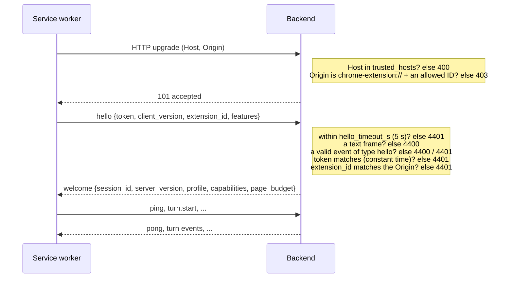
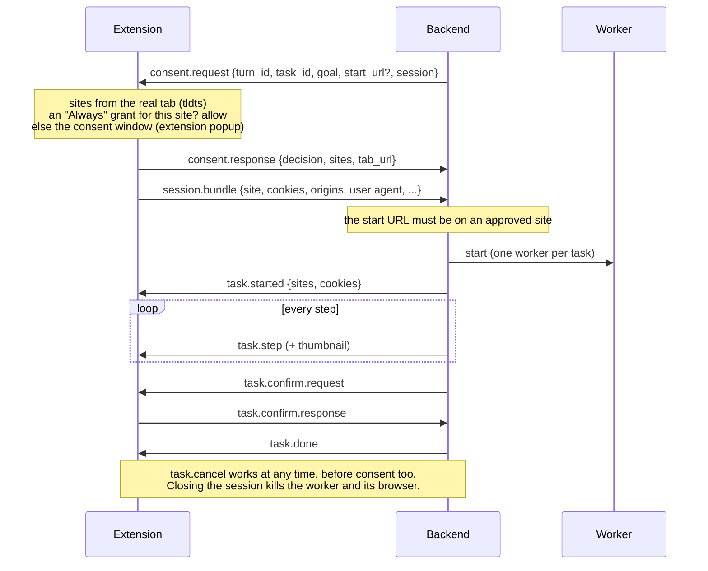
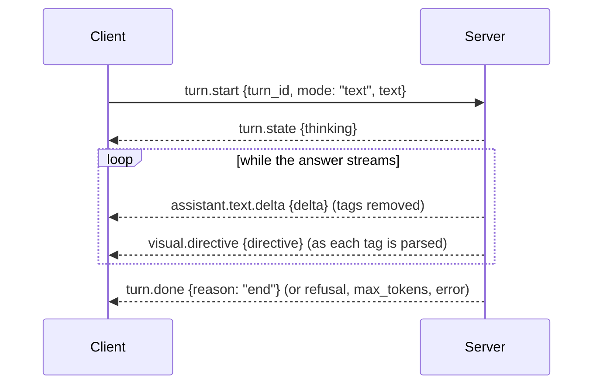
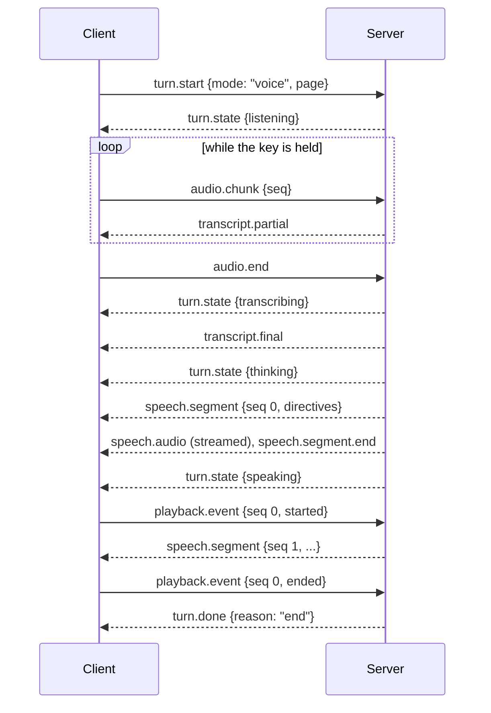
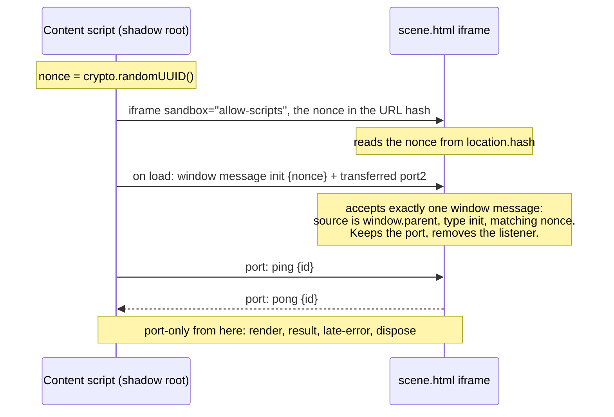
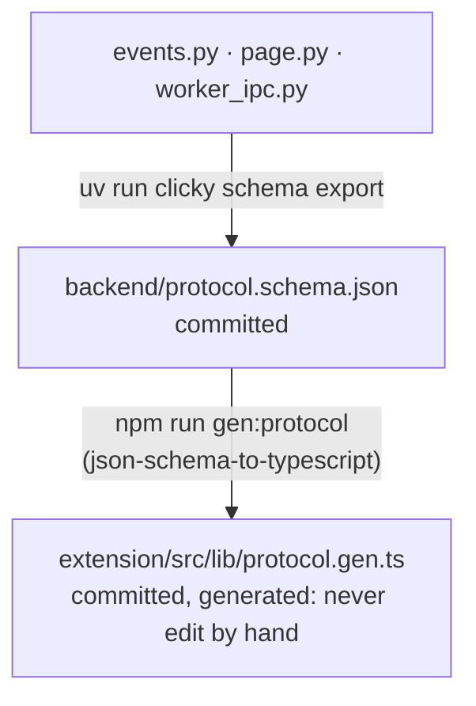

# Protocol

This document describes every channel between ClickyTabs's parts:

1. [WebSocket wire protocol](#websocket-wire-protocol): extension service worker <-> backend.
2. [Scene sandbox handshake](#scene-sandbox-handshake): content script <-> `scene.html` iframe.
3. [Extension-internal messages](#extension-internal-messages): pages and content scripts <-> service worker.
4. [Worker IPC](#worker-ipc): backend <-> automation worker.

**Source of truth.** The wire protocol and worker IPC are Pydantic v2 models:

- `backend/src/clicky/protocol/events.py` — client and server events, directives;
- `backend/src/clicky/protocol/page.py` — page context;
- `backend/src/clicky/protocol/worker_ipc.py` — worker commands and events.

If this document and the models disagree, the models win; fix the document. See [Schema drift gate](#schema-drift-gate).

## WebSocket wire protocol

### Transport

- **Endpoint:** `ws://127.0.0.1:8765/v1/ws` by default (host and port from `CLICKY_HOST` / `CLICKY_PORT`).
- **Client:** only the extension's **service worker** connects. Content scripts never talk to the backend.
- **Frames:** JSON **text** frames, one event per frame, UTF-8. Binary frames are a protocol error.
- **Discriminators:** every event has a `type` field; every directive has a `kind` field. They are required on the
  wire.
- **Strictness:** all models use `extra="forbid"`; unknown fields or unknown `type` values fail validation.
- **Keepalive:** the client sends an application `ping` every 20 s (this also keeps the MV3 service worker alive);
  the server answers `pong`. uvicorn additionally sends protocol-level pings every 20 s.
- **HTTP endpoints:** `GET /healthz` (liveness, no auth) and `GET /v1/info` (minimal, no capability details).
  Capability details are only sent in the authenticated `welcome`.

### Handshake and authentication

Authentication has three parts, all required:

| Check | Where | Detail |
|---|---|---|
| Host header | `TrustedHostMiddleware` | `trusted_hosts`, default `127.0.0.1`, `localhost`. Blocks DNS rebinding. |
| Origin | before `accept()` | Must be `chrome-extension://<id>` with `<id>` in `allowed_extension_ids` (default: the pinned dev ID from `extension/keys/dev-extension-id.txt`). |
| Pairing token | first frame (`hello.token`) | Compared with `hmac.compare_digest`. Stored in `CLICKY_HOME/.clicky/auth_token`, or `CLICKY_AUTH_TOKEN`. Shown by `clicky token show`, rotated by `clicky token rotate`. |
| Extension ID | first frame (`hello.extension_id`) | Must match the ID in the Origin. |

### Close codes

| Code | Meaning | Extension behavior |
|---|---|---|
| 4401 | Unauthorized: bad token, extension ID mismatch, first event not `hello`, or `hello` missing/late (`hello_timeout_s`); also sent to every open session when the pairing token is rotated on a running backend | **Terminal** state `unauthorized`: no reconnects until the user re-pairs (onboarding or popup Re-pair). |
| 4400 | Protocol error: binary first frame or malformed `hello` | Treated as an error; reconnects with backoff. |
| 1006 (observed) | The server rejected the Origin before accepting (HTTP 403 at the upgrade; the server code is 4403). Browsers report only 1006. | The SW probes `GET /healthz`. If it succeeds, the state becomes `rejected` with the hint "backend reachable but handshake rejected — extension ID not allowed?"; otherwise `disconnected`. |
| 1000 / 1001 | Normal close / server going away | Reconnect with backoff (≤ 25 s) plus a 30 s `chrome.alarms` reconnect; the alarm also runs while connected, as a watchdog that restarts a stopped service worker. |

### Client -> server events

| `type` | Fields | Purpose |
|---|---|---|
| `hello` | `token: str`, `client_version: str`, `extension_id: str`, `features: str[] = []`, `conversation_id: str?` (`^[A-Za-z0-9_-]{8,64}$`) | First frame; authenticates the session and names the conversation to continue (an unknown id starts a new one with that id) |
| `ping` | `t: float?` | Keepalive; echoed in `pong.t` |
| `turn.start` | `turn_id: str`, `mode: "text" \| "voice"`, `text: str?`, `tab_id: int?`, `page: PageContext?` | Starts a turn. Text mode carries `text`; voice mode is followed by `audio.chunk`s |
| `turn.cancel` | `turn_id: str` | Cancels the active turn (also used for barge-in) |
| `audio.chunk` | `turn_id: str`, `seq: int ≥ 0`, `data_b64: str`, `mime: str = "audio/webm;codecs=opus"` | Microphone audio, 100 ms chunks |
| `audio.end` | `turn_id: str` | PTT released; no more audio |
| `playback.event` | `turn_id: str`, `seq: int`, `state: "started" \| "ended" \| "interrupted"`, `at_ms: float` | Playback progress of a `speech.segment` (drives directive timing) |
| `scene.result` | `scene_id: str` (`^[A-Za-z0-9_-]{8,64}$`), `attempt: int = 1`, `ok: bool`, `error: str? ≤ 2000`, `unavailable: bool = false` | The sandbox ran a `scene.render`: drawn, or why not (with the failing line). A failure gets one repair; `unavailable` (no stage, closed by the user, no answer) never does |
| `consent.response` | `task_id: str`, `decision: "allow_once" \| "always" \| "deny"`, `sites: str[] ≤ 4` (registrable domains, lowercase), `tab_url: str?` | The user's answer in the consent window (or an "Always" grant). `sites` are what the extension worked out from the real tab URL and the start URL: the tab's site, plus the task's for a cross-site task. `always` is never sent for cross-site |
| `session.bundle` | `task_id: str`, `site: str` (the cookie scope), `cookies: CookieRecord[] ≤ 500`, `origins: OriginStorage[] ≤ 4`, `user_agent: str?`, `locale: str?`, `timezone: str?`, `viewport: [int, int]?` | The user's login, collected after consent when the task asked for it: cookies of the tab's registrable domain only (partitioned ones included) and the tab origin's localStorage, plus what keeps the agent's browser alike (UA, language, time zone, viewport). The backend drops anything outside `site` again |
| `task.confirm.response` | `task_id: str`, `request_id: str`, `approved: bool`, `note: str?` | Answer to `task.confirm.request` |
| `task.cancel` | `task_id: str` | Stops a running browser task |
| `conversation.reset` | — | Forget the conversation so far (a running turn is cancelled); answered by `conversation.started` |
| `config.get` | `request_id: str` (`^[A-Za-z0-9_-]{8,64}$`) | The options page asks for the runtime configuration; answered by `config.state` with the same `request_id` |
| `config.set` | `request_id: str`, `profile: "local" \| "cloud" \| "hybrid"?`, `capability: str?`, `choice: ProviderChoiceWire?`, `reset: bool = false` | Switch the profile and/or one capability's provider for the then-active profile, without a restart; `reset` drops the page's choice for `capability`. Answered by `config.state` (with `error` when refused: nothing changed) and broadcast to every session |

`?` = optional (nullable, default `null`).

**`ProviderChoiceWire`**: `provider: str` (`^[a-z][a-z0-9_]{0,31}$`), `model: str? ≤ 200`,
`options: {str: str | float | bool}` with keys from `voice`, `voice_id`, `effort`, `speed` only (string values ≤ 200).
Base URLs, hosts and keys can't be set over the socket (`clicky.toml` / `.env` only).

**`CookieRecord`**: `name`, `value`, `domain`, `path = "/"`, `expires: float?` (unix seconds; null = session cookie),
`http_only = false`, `secure = false`, `same_site: "Strict" | "Lax" | "None" | null`, `host_only = false`,
`partition_key: str?` (top-level site for CHIPS cookies).

**`OriginStorage`**: `origin: str`, `local_storage: {str: str}`.

#### Page context (`page.py`)

| Model | Fields |
|---|---|
| `PageContext` | `url: str ≤ 4096` (fragment dropped, secret-looking parameters redacted), `title: str ≤ 500`, `viewport: Viewport`, `screenshot: Screenshot?`, `elements: ElementMark[] ≤ 400`, `selection: str? ≤ 4000`, `text_excerpt: str? ≤ 20000` (budgeted visible text), `scene: OpenScene?`. All of it is **untrusted** |
| `OpenScene` | `scene_id: str`, `title: str ≤ 200`: the scene the stage is showing, so a follow-up ("make it spin faster") edits it |
| `Viewport` | `width: int ≥ 1`, `height: int ≥ 1` (CSS px), `dpr: float > 0 = 1.0`, `scroll_x = 0`, `scroll_y = 0` |
| `Screenshot` | `data_b64: str` (≤ 6 MB of base64; already resized to the model's budget; text fields masked), `mime: "image/jpeg" \| "image/png" \| "image/webp"`, `width`, `height` ≤ 8192 (pixel size of this image; element boxes and directive coordinates refer to it) |
| `ElementMark` | `id: "e1"…"e9999"` (stable for the turn), `role: str`, `name: str ≤ 200` (accessible name; never input values), `tag: str` (`input:<type>` for inputs), `level: 1–6?` (headings), `states: ("disabled" \| "checked" \| "mixed" \| "selected" \| "expanded" \| "collapsed" \| "pressed" \| "required" \| "readonly" \| "current")[] ≤ 10`, `bbox: [x, y, w, h]` in screenshot pixels (CSS px when there is no screenshot) |
| `PageBudget` | `vision: bool`, `image_long_edge`, `image_max_pixels`, `jpeg_quality`, `max_elements`, `max_text_chars`, `max_name_chars`: what the active brain gets; sent in `welcome` |

### Server -> client events

| `type` | Fields | Purpose |
|---|---|---|
| `welcome` | `session_id: str`, `server_version: str`, `profile: str`, `capabilities: CapabilityStatus[]`, `page_budget: PageBudget?`, `conversation_id: str?`, `conversation_turns: int = 0` | Handshake accepted; effective provider chain + health per capability; how much page context to capture; the conversation this session continues (the client stores its id for the next `hello`) |
| `pong` | `t: float?` | Reply to `ping` |
| `error` | `code: str`, `message: str`, `turn_id: str?`, `retryable: bool = false` | Codes include `bad_request`, `unsupported`, `provider_error`, `provider_unavailable`, `internal_error` |
| `turn.state` | `turn_id: str`, `state: "listening" \| "transcribing" \| "thinking" \| "speaking" \| "acting" \| "idle"` | Drives the Orb |
| `assistant.text.delta` | `turn_id: str`, `delta: str` | Streaming assistant text |
| `turn.done` | `turn_id: str`, `reason: "end" \| "cancelled" \| "error" \| "refusal" \| "max_tokens"`, `detail: str?`, `metrics: {str: float}?` | Exactly one per accepted turn. Voice turns report `stt_ms`, `brain_first_token_ms`, `first_audio_ms`, `total_ms` (from key release) |
| `capability.status` | `status: CapabilityStatus` | Health change of one capability |
| `transcript.partial` | `turn_id: str`, `text: str` | Live STT text |
| `transcript.final` | `turn_id: str`, `text: str` | Final transcript |
| `speech.segment` | `turn_id: str`, `seq: int ≥ 0`, `text: str`, `mime: str` (`audio/pcm` = PCM16 mono, streamed), `sample_rate: int?`, `directives: TimedDirective[]` | Announces one spoken sentence with the directives written in it; its audio follows |
| `speech.audio` | `turn_id: str`, `seq: int ≥ 0` (the sentence), `index: int ≥ 0`, `data_b64: str` | One chunk of the sentence's audio, in order |
| `speech.segment.end` | `turn_id: str`, `seq: int ≥ 0`, `duration_ms: float`, `char_times_ms: float[]?` | No more audio for the sentence; exact per-character times when the TTS reports alignment |
| `visual.directive` | `turn_id: str`, `directive: Directive` | An untimed directive, applied at once: every directive of a text turn; in a voice turn, one written after the last spoken sentence started, or any when there is no voice |
| `scene.building` | `turn_id: str`, `scene_id: str`, `kind: "three" \| "canvas" \| "svg" \| "html"`, `title: str = ""` | The brain asked for a scene and the codegen model is writing it: the stage opens with a placeholder. Scene events outlive their turn |
| `scene.render` | `turn_id: str`, `scene_id: str`, `kind`, `title: str = ""`, `code: str`, `attempt: int = 1`, `codegen_ms: float?` | Code for the scene sandbox; `attempt` 2 is the automatic repair |
| `scene.failed` | `turn_id: str`, `scene_id: str`, `error: str` | No scene this time: codegen failed, or the repaired code still didn't render |
| `consent.request` | `turn_id: str`, `task_id: str`, `goal: str`, `start_url: str?` (validated http(s)), `session: bool` | The brain proposed a browser task. Sent before the turn's `turn.done`. The extension works out the sites itself from the turn's tab (cookie scope = that tab's registrable domain, never the model's) and opens the consent window, or allows it at once under an "Always" grant |
| `task.started` | `task_id: str`, `goal: str`, `sites: str[]`, `cookies: int` | The worker started; how many of the user's cookies its browser got |
| `task.step` | `task_id: str`, `n: int`, `action_text: str`, `url: str?`, `thumb_b64: str?` | Progress for the tracker |
| `task.confirm.request` | `task_id: str`, `request_id: str`, `question: str` | Pause before an irreversible step |
| `task.done` | `task_id: str`, `success: bool`, `summary: str`, `final_url: str?` | Task finished |
| `setup.progress` | `item: str` (e.g. `ollama:qwen3.5:4b`), `status: str`, `completed: int?`, `total: int?` | Model download progress. Reserved: not sent yet (models are pulled with `clicky models pull`, which shows its own progress) |
| `config.state` | `request_id: str?`, `profile: str`, `profile_pinned: bool`, `profiles: str[]`, `tier: str`, `capabilities: CapabilityConfig[]`, `page_budget: PageBudget?`, `error: str?` | The runtime configuration: the answer to `config.get` / `config.set`, and pushed (without `request_id`) to every session after a change. The extension applies `page_budget` (the brain may have changed) |
| `conversation.started` | `conversation_id: str` | After `conversation.reset`: the new conversation (the client stores its id) |

**`CapabilityStatus`**: `capability: str`, `provider: str`, `model: str?`, `kind: "paid" | "open" | "test"`,
`source: "api" | "ollama" | "huggingface" | "local"`, `ok: bool`, `reason: str = ""`, `hint: str = ""`,
`chain: str[]` (`"provider:model"` in fallback order, active first).

**`CapabilityConfig`**: `capability: str`, `status: CapabilityStatus`, `choice: ProviderChoiceWire?` (what the
options page set; null = `clicky.toml` or the preset), `providers: ProviderOption[]`, `voices: VoiceOption[]` (TTS:
the active provider's voices), `voice_key: str?` (`voice` or `voice_id`). **`ProviderOption`**: `name`, `kind`,
`source`, `available: bool` (package installed and API key set), `reason`, `default_model`, `needs_model`,
`models: str[]` (local Ollama models, for Ollama providers). **`VoiceOption`**: `id`, `name`.

The backend saves the page's choices in `CLICKY_HOME/.clicky/ui-settings.json` (owner-only). Precedence: the profile
from `CLICKY_PROFILE` (or `clicky serve --profile`) pins it (`profile_pinned`), else the page's choice, else
`clicky.toml` / `.env`; a capability's provider from the page goes first, with the `clicky.toml` override or the preset
chain behind it as fallbacks.

### Directives

Directives are discriminated by `kind`. The brain writes them as inline tags (see
[ARCHITECTURE.md](ARCHITECTURE.md#directive-grammar)); the backend parses them into these models.

| `kind` | Fields | Notes |
|---|---|---|
| `point` | `to: str?`, `x: float?`, `y: float?`, `label: str?` | `to` (element mark id) preferred; `x`/`y` in screenshot px as fallback |
| `mark` | `to: str`, `style: "circle" \| "box" \| "underline" \| "glow" = "circle"`, `label: str?` | |
| `arrow` | `source: str`, `target: str`, `label: str?` | Element id or `"x,y"`. The tag uses `from`/`to`; the wire uses `source`/`target` |
| `path` | `points: [float, float][]`, `label: str?` | Screenshot px |
| `scroll` | `to: str` | Element id |
| `clear` | — | Removes all annotations |

**`TimedDirective`**: `at_char: int ≥ 0` (offset into the segment's spoken `text`: where the tag was written, i.e. the
start of the words that name its target), `directive: Directive`. The content script fires it at
`segment_start + duration_ms × at_char / len(text)`, or at the exact character time when the TTS reports alignment.

The backend validates every directive before sending it: element ids must exist in the turn's page, coordinates are
converted from the model's convention to screenshot pixels and must lie on the screenshot, at most 8 per reply.
A `<scene kind title>brief</scene>` block becomes a scene job (`scene.building` → `scene.render` → `scene.result`,
see [ARCHITECTURE.md](ARCHITECTURE.md#scenes)) when the turn came from a tab; its brief is never spoken. `<task>`
tags start the consent flow (`consent.request`, see Browser tasks below).

### Browser tasks

One task per session at a time (a second one is answered `task.done {success: false}` at once). No answer to the
consent request within 3 minutes (the window gives up after 2.5) is a refusal; so is closing the window.

### Conversations

A session continues one conversation. The extension stores `welcome.conversation_id` in `chrome.storage.session` and
sends it in every `hello`, so reconnects and service-worker restarts keep the history; the server keeps conversations
in memory (a backend restart forgets them; an unknown id starts a new conversation with that id). Answered turns are
recorded, including replies cut off by barge-in (as far as they got); refused and failed turns are not.
`conversation.reset` cancels any running turn and starts a new conversation (`conversation.started`). A conversation
idle for 20 minutes starts afresh on its next turn.

### Turn lifecycle

At most **one turn per session** is active. A `turn.start` while a turn is running **barges in**: the running turn
is cancelled (it ends with `turn.done {reason: "cancelled"}`) and the new turn starts. Every accepted turn ends with
exactly one `turn.done`. A `turn.start` that fails validation (for example an oversized page) but has a usable
`turn_id` gets `error {code: "bad_request", turn_id}` and `turn.done {reason: "error"}` too, so clients never wait on it
.

**Text turn:**

Errors inside the turn produce `error {turn_id, ...}` followed by `turn.done {reason: "error"}`.

**Voice turn:**

### Cancellation and barge-in

- `turn.cancel {turn_id}` cancels the turn task. Provider streams are consumed with `contextlib.aclosing()`, so the
  upstream HTTP request (Ollama, Anthropic, ...) is closed immediately. The server answers
  `turn.done {reason: "cancelled"}`.
- **Barge-in:** pressing PTT while the assistant speaks makes the SW stop playback (the offscreen player reports
  `playback.event {state: "interrupted"}`), send `turn.cancel` for the old turn, and start a new `turn.start`.
- A cancel whose `turn_id` is not the active turn does not affect the active turn.
- Fallback providers only take over before the first delta or audio byte; afterwards a failure ends the turn.

## Scene sandbox handshake

`scene.html` is an extension **sandbox page** (opaque origin, may `eval`, CSP `connect-src 'none'`, workers only
from `blob:`). It is web accessible with `use_dynamic_url`, so its URL changes per session and can't be guessed by
pages.

Rules:

- The nonce travels only in the URL hash and the single `init` message.
- `targetOrigin` must be `"*"` because the sandbox origin is opaque; security comes from the nonce, the transferred
  port and the `event.source` checks on both sides (the content script only accepts messages whose
  `event.source === iframe.contentWindow`).
- After `init`, the window `message` listener is removed. All traffic goes over the `MessagePort`; window messages
  are ignored.
- No conversation data or tokens are ever sent into the sandbox.

Port messages (`lib/scene/types.ts`):

| Message | Direction | Meaning |
|---|---|---|
| `ping` → `pong {at}` | content ⇄ sandbox | Liveness |
| `render {sceneId, attempt, kind, code}` | content → sandbox | Run a scene, replacing the one showing (≤ 60 000 characters of code) |
| `result {sceneId, attempt, ok, error?, stats?}` | sandbox → content | Exactly one per render: drawn (`stats`: objects, painted share, removed markup) or why not. The stage forwards it as `scene.result` |
| `late-error {sceneId, error}` | sandbox → content | A scene that had rendered broke later (shown on the stage; no repair) |
| `dispose` | content → sandbox | Stop the Worker and clear the page |

Inside the sandbox, three/canvas scenes run in a `blob:` Worker: `init {token, kind, canvas (transferred
OffscreenCanvas), width, height, dpr, code}`, then `resize` and forwarded `event`s; the Worker answers `heartbeat`,
`ready {stats}`, `error {phase, message}` and `cursor`, each carrying the init `token`. Messages without it (scene code
calling `postMessage` itself) are ignored.

## Extension-internal messages

Typed in `extension/src/lib/messages.ts`; sent with `chrome.runtime.sendMessage` (or a `chrome.runtime.Port`) and
validated by the service worker's sender rules:

- `sender.id` must equal the extension's own ID.
- Page data and consent are accepted only from **frameId 0 of the turn's tab**.
- Hotkey frames (all frames, including about:blank and srcdoc) may send **only** `ptt.*`.
- HUD turns (`turn.text`, `turn.stop`) are accepted only from the **top frame** of a tab; the worker routes a turn's
  events back to that tab only.
- Settings writes are accepted only from extension pages (onboarding, popup, options), never from content scripts.

| Message | Direction | Sender | Purpose |
|---|---|---|---|
| `ptt.down` / `ptt.up` | content (hotkeys) -> SW | any frame of a tab | Raw push-to-talk key events; the SW owns the PTT state machine |
| `status.get` | content -> SW | any frame | Connection state + this tab's Orb state (`PublicStatus`) |
| `status.changed` / `orb.state` / `ptt.state` / `orb.toggle` / `prefs.changed` | SW -> content | SW | Pushed on change (`prefs.changed` reaches every frame) |
| `settings.get` | content -> SW | any frame | Non-sensitive prefs only: PTT chord, orb mode (`dock`/`follow`) and whether this site is disabled |
| `settings.read` / `settings.set` | pages -> SW | extension pages only | Read (token never echoed, only `hasToken`) / validated write of backend URL, token, chord, orb mode, disabled sites, the developer latency timeline |
| `turn.text` | content -> SW | top frame | HUD text turn (trimmed, ≤ 4000 chars). The SW sends `turn.start{mode:"text", tab_id}` and replies `{ok, turn_id}` or `{ok:false, error}`; a new turn replaces the tab's previous one |
| `turn.stop` | content -> SW | top frame | Cancels this tab's turns (`turn.cancel` upstream) |
| `turn.event` | SW -> content | SW | `turn.state`, `assistant.text.delta`, `visual.directive`, `error`, `turn.done` of a turn this tab started. Tab close or navigation cancels the turn; a lost connection ends it with `turn.done{error}` |
| `demo.run` | page -> SW -> content | extension pages | Plays the scripted overlay tour on that tab (no backend needed) |
| `context.snapshot` / `context.restore` | SW -> content | SW | DOM snapshot for a turn under the budget (hiding the companion and showing the capture sentinel when `hideUi`), plus the open scene; then show it again, with the screenshot size for mapping `x,y` directives |
| `debug.pageContext` | page -> SW -> content | extension pages | The page context a turn would send now, with snapshot phases, total time and capture health (attempts, stale frames, error); optional `budget: "full" \| "compact"` captures at that named budget instead of the active brain's |
| `conversation.reset` | page -> SW | extension pages | The popup's "New conversation": sends `conversation.reset` upstream; `{ok:false}` when not connected |
| `debug.marks` | page -> SW -> content | extension pages | Outlines every mark with its id on the page ("Show what the brain sees") |
| `rec.start` / `rec.stop` / `rec.cancel` | SW -> offscreen | SW | Push-to-talk recorder (ordered queue) |
| `rec.chunk` / `rec.level` / `rec.done` | offscreen -> SW | offscreen | 100 ms webm/opus slices (≤ 1 MB each), mic level, end of recording (after the last slice) |
| `play.segment` / `play.audio` / `play.end` / `play.stop` | SW -> offscreen | SW | Speech for the player, in order; `play.stop` = barge-in |
| `play.event` / `play.level` | offscreen -> SW | offscreen | A sentence `started` (audible in `inMs`), `ended`, `interrupted`, or all audio so far finished (`idle`); speech level |
| `voice.turn` / `voice.error` / `voice.level` / `speech.playback` | SW -> content | SW | A push-to-talk turn started here / could not start (no backend, no mic) / mic or speech level / playback progress |
| `debug.voice` | page -> SW | extension pages | Recent push-to-talk turns: key down/release, first audible answer, release → audible latency, mic start time, chunks, transcript, outcome, backend metrics |
| `debug.state` | page -> SW -> content | extension pages | Orb state, visibility, connection, whether `storage.local` is locked, orb mode, HUD open, annotation count, the latest directive and the text of its target, caption, a layout probe (orb rect, hit-test at the orb, top-layer state, canvas size) and the scene stage (status, attempt, error, codegen time, render stats). the error, whether a turn is in flight, the last turn's latency timeline. The shadow root is closed, so tests ask |
| `debug.scenePing` | page -> SW -> content | extension pages | Round-trips a ping through the scene sandbox handshake |
| `scene.event` | SW -> content | SW | `scene.building` / `scene.render` / `scene.failed` of a scene this tab's turn asked for (the SW maps scene id → tab; a render no tab acknowledges is answered `unavailable`) |
| `scene.result` | content -> SW | top frame of the tab that owns the scene | The stage's verdict on a render, forwarded upstream as `scene.result` |
| `debug.sceneRender` / `debug.sceneClose` | page -> SW -> content | extension pages | Render code straight into a tab's stage without the backend (sandbox tests); close the stage |
| `task.event` | SW -> content | SW | A browser task this tab asked for: `task.consent` (the sites, whether the login is shared and how many cookies, waiting for the window or allowed by an "Always" grant), `task.started`, `task.step`, `task.confirm.request`, `task.done` |
| `context.storage` | SW -> content | SW | The tab origin's localStorage, only after the user allowed a task to use their login (the SW checks the origin is on the tab's site) |
| `consent.get` / `consent.decide` | consent window -> SW | the consent window the SW opened for that task (extension page, same window id, `consent.html`) | What to show (worked out by the SW, never by the model) / the user's real-click answer: `allow_once`, `always` (same-site only), `deny` |
| `task.stop` / `task.answer` / `task.open` | content -> SW | top frame of the tab that owns the task | The tracker: stop the task (also before consent), answer the agent's question, open the final page in this tab (only a URL on one of the task's sites) |
| `grants.list` / `grants.remove` / `grants.clear` | options -> SW | extension pages | The sites a task may use without the consent window ("Always"); forget all. Grants lapse 90 days after their last use, are capped at 50, and are cleared when the backend URL changes |
| `config.get` / `config.set` | options -> SW -> backend | extension pages | The runtime configuration (`config.state`, or `{ok:false, error}` when not connected or no answer within 45 s); `config.set` takes `{profile?, capability?, choice?, reset?}`, validated like the wire event |
| `worker.started` | SW -> content | SW | A new service worker started: the content script ends a turn in flight ("the connection to the backend was interrupted"), clears push-to-talk, marks a running task stopped and tells the scene stage the connection was lost |
| `debug.taskAnswer` | page -> SW -> content | extension pages | Tests: answer the tracker's question (its buttons are in the closed shadow root) |
| `debug.offscreenPing` / `debug.micProbe` | page -> SW -> offscreen | extension pages | Offscreen liveness; 1 s background `getUserMedia` probe (records `mic` in `storage.session`) |
| `debug-turn` (Port) | popup <-> SW | popup | Long-lived port for the popup's debug text turn: start, streaming deltas, cancel, done |
| `offscreen-lifeline` (Port) | offscreen <-> SW | offscreen document | Held open by the offscreen document. Worker gone: the document cancels the recording and playback, then reconnects (starting a new worker). Document gone: the worker ends the voice turn it was recording or speaking. `rec.chunk` for a turn the worker doesn't know is answered `{ok:false}`, and the recorder stops |

Connection state lives in `chrome.storage.session` under `conn` (`unpaired`, `connecting`, `connected`,
`disconnected`, `unauthorized`, `rejected`); the conversation id under `conversation`. Secrets (token, backend URL, consent grants under `taskGrants`) live in
`chrome.storage.local` with access level `TRUSTED_CONTEXTS`, so content scripts can't read them.

## Worker IPC

The backend drives the automation worker (`backend/automation-worker`, package `clicky_worker`) over stdio.

- **Framing:** JSON lines: one JSON object per line, `\n`-terminated, no embedded newlines.
- **Encoding:** UTF-8 both ways. The child runs with `PYTHONUTF8=1`; pipes are opened with `encoding="utf-8"`;
  non-ASCII stays as UTF-8 (not `\u` escapes).
- **stdout guard:** the worker re-routes stray `print` / library output on stdout to stderr, so stdout carries only
  protocol lines. stderr is drained to a log file by a reader thread.
- **Secrets:** API keys travel **only via the child process environment**, never over IPC and never on the command
  line.
- **Process:** `subprocess.Popen` with reader threads (not asyncio subprocesses, which uvicorn's Windows reload loop
  can't spawn), inside a **Windows Job Object with kill-on-close**, so the headed browser can't outlive the backend.
- **Models:** defined in `worker_ipc.py`. The worker runs in its own environment and can't import `clicky`, so
  `clicky_worker/ipc.py` mirrors them; a test asserts both produce identical JSON Schemas.

Backend -> worker commands (`type`):

| `type` | Fields |
|---|---|
| `ping` | `nonce: str`, `payload: str = ""` |
| `task.start` | `task_id`, `goal`, `start_url?`, `storage_state: object?` (Playwright `{cookies, origins}`), `llm: AgentLLMConfig`, `browser: BrowserConfig`, `limits: TaskLimits` |
| `task.cancel` | `task_id` |
| `confirm.response` | `task_id`, `request_id`, `approved: bool`, `note?` |
| `shutdown` | — |

- `AgentLLMConfig`: `provider: "anthropic" | "openai_compat" | "ollama" | "fake"`, `model: str`, `base_url: str?`,
  `options: object`.
- `BrowserConfig`: `headless = false`, `user_agent?`, `locale?`, `timezone?`, `viewport: [int, int]?`,
  `allowed_domains: str[]`.
- `TaskLimits`: `max_steps = 40`, `step_timeout_s = 180.0`.

Worker -> backend events (`type`):

| `type` | Fields |
|---|---|
| `ready` | `version: str`, `mode: "stub" \| "live"` (first line after start) |
| `pong` | `nonce`, `payload` |
| `task.step` | `task_id`, `n`, `action_text`, `url?`, `thumb_b64?` |
| `confirm.request` | `task_id`, `request_id`, `question` |
| `task.done` | `task_id`, `success`, `summary`, `final_url?` |
| `task.error` | `task_id?`, `message` |
| `log` | `level: "debug" \| "info" \| "warning" \| "error"`, `message` |

`python -m clicky_worker --stub` answers `ping` with `pong` (used by the IPC round-trip test).

## Schema drift gate

- `scripts/gen-protocol.ps1` runs both steps.
- `uv run python -m clicky.protocol.export --check` exits 1 if the committed schema is stale; the backend test suite
  runs the same check.
- The extension suite fails if `npm run gen:protocol` would change `protocol.gen.ts`.
- Changes must stay backward compatible within a release: add optional fields, don't rename or remove.
