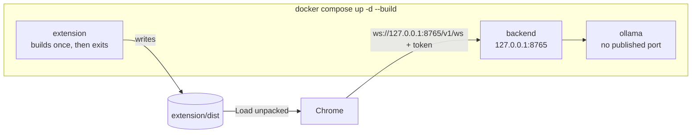
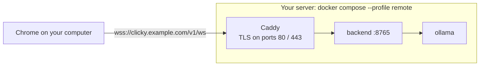

# Running ClickyTabs

ClickyTabs has two parts, and you always run both:

- **The backend** (`backend/`), a Python server that does the speech, the thinking and the browser tasks. It holds
  your API keys and a pairing token, and listens on `ws://127.0.0.1:8765/v1/ws`.
- **The extension** (`extension/`), which lives in Chrome. It only ever talks to *your* backend, paired with that
  token.

| | Use it when | Section |
|---|---|---|
| Docker | The easy way: one command builds and starts everything | [1](#1-docker) |
| From source | You develop on it, have Ollama and models already, use a Mac's GPU, or want to watch the agent's browser | [2](#2-from-source) |
| Docker on a server, with TLS | The extension runs on another computer than the backend | [3](#3-host-the-backend-on-a-server) |

## 1. Docker

You need Docker (Docker Desktop on Windows and macOS; on Windows it uses WSL 2) and Chrome 120+.

```bash
git clone https://github.com/cpohagwu/clickytabs.git
cd clickytabs
docker compose up -d --build
```

This builds and starts three services:



| Service | What it does |
|---|---|
| `backend` | The ClickyTabs server on `127.0.0.1:8765`, with the speech extras, the Claude SDK and the browser-task agent (headless Chromium) |
| `ollama` | Its own Ollama for the local models; no published port, so an Ollama you already run is untouched |
| `extension` | Builds the Chrome extension, copies it to `extension/dist`, and exits |

Then:

1. **Models.** `docker compose exec backend clicky models pull --profile local` (several GB, once). Add `--dry-run`
   to see the list first. For the `cloud` profile, skip this and add keys instead (below).
2. **The extension.** `chrome://extensions` > **Developer mode** > **Load unpacked** > the `extension/dist` folder.
3. **Pairing.** The welcome page opens: the backend URL is `ws://127.0.0.1:8765/v1/ws`, and
   `docker compose exec backend clicky token show` prints the token.
4. **The microphone.** Allow it and choose **Allow on every visit**. Then hold **Right Ctrl** on any page and ask.

### API keys and settings

Compose reads `backend/.env` if it exists. Create it from `backend/.env.example` and fill in only what you use:

- `ANTHROPIC_API_KEY` for Claude (the `cloud` and `hybrid` brain), `DEEPGRAM_API_KEY` and `ELEVENLABS_API_KEY` for
  cloud speech, `OPENAI_API_KEY` for the OpenAI fallbacks;
- `CLICKY_HARDWARE_TIER` to pick the local models' size (next section);
- `CLICKY_PROFILE` pins the profile. Leave it out to choose the profile on the options page.

Run `docker compose up -d` after changing it. For per-capability model overrides (`clicky.toml`), run the backend
from source, or mount a `clicky.toml` into `/data` (the backend's `CLICKY_HOME`).

### With an NVIDIA GPU

```bash
docker compose -f compose.yaml -f compose.gpu.yaml up -d --build
```

- **Driver:** the NVIDIA driver on the host is enough on Windows (Docker Desktop passes the GPU through WSL 2). On
  Linux, also install the
  [NVIDIA Container Toolkit](https://docs.nvidia.com/datacenter/cloud-native/container-toolkit/latest/install-guide.html).
- **Tier:** the GPU belongs to the Ollama container, so the backend can't detect it. Set the tier in `backend/.env`,
  for example `CLICKY_HARDWARE_TIER=gpu-8gb` ([which tier](MODELS.md#hardware-tiers)), before pulling the models.
- **No GPU support:** Docker on macOS can't use the GPU, and AMD support depends on your Ollama build. On those
  machines run the backend [from source](#2-from-source) with the native Ollama app.

### Day to day

| Task | Command |
|---|---|
| Status / logs | `docker compose ps`, `docker compose logs -f backend` (the log never contains the token or keys) |
| What each capability uses, and whether it's healthy | `docker compose exec backend clicky config show` |
| Stop / start | `docker compose down` / `docker compose up -d` |
| Update | `git pull`, `docker compose up -d --build`, then press the reload arrow on ClickyTabs in `chrome://extensions` |
| A new pairing token | `docker compose exec backend clicky token rotate` (the extension then asks to be paired again) |
| Another port | Set `CLICKY_PORT=18765` in a `.env` file next to `compose.yaml`, and pair with that port |

**Data:** the models live in the `ollama-models` volume, and the token, settings and Kokoro files in `clicky-data`.
`docker compose down` keeps both; `docker compose down -v` deletes them, and with them the token.

**Browser tasks** run in a headless Chromium inside the container: you follow them in the tracker (each step has a
screenshot), not in a window. That Chromium runs without its own sandbox, so the container is the boundary. For a
visible browser with its sandbox, run the backend from source.

## 2. From source

You need Python 3.12 with [uv](https://docs.astral.sh/uv/) (it installs Python itself), Node.js 22+ with npm,
[Ollama](https://ollama.com) 0.40.13+ for the `local` profile, and Chrome 120+. If the Docker backend is running,
stop it first (`docker compose down`): both use port 8765.

### The backend

```bash
cd backend
uv sync --extra local --extra kokoro          # + --extra anthropic for Claude; --extra cloud for every paid SDK
uv sync --directory automation-worker         # once, for browser tasks (installs browser-use)
uv run clicky doctor                          # hardware, Ollama, models, keys: what will work
uv run clicky models pull --profile local     # local models (several GB; skip for the cloud profile)
uv run clicky serve                           # ws://127.0.0.1:8765/v1/ws
```

- **Profiles:** `local` (the default, no keys), `cloud` and `hybrid` (keys in `backend/.env`, copied from
  `.env.example`). Choose on the options page once paired, or pin one with `uv run clicky serve --profile cloud`.
- **Models:** `clicky.toml` (copy `clicky.toml.example`) sets the hardware tier, per-capability overrides, the Ollama
  host and its runner options. See [MODELS.md](MODELS.md).
- **The pairing token:** `uv run clicky token show` prints it. `uv run clicky token rotate` replaces it; a running
  backend applies it within 2 seconds and disconnects the extension, which then asks to be paired again.
- `uv sync` installs exactly the extras you list and removes the others, so always list all of the ones you use. On
  Windows, stop `clicky serve` first.

### The extension

```bash
cd extension
npm ci
npm run build                                 # writes .output/chrome-mv3
```

Load `extension/.output/chrome-mv3` with **Load unpacked** and pair it as in [section 1](#1-docker). The extension
ID is always `fhgliaahcafninaodeelekpdemjkifmf`, the one the backend accepts by default.

After you pull new code, run `npm run build` again and press the reload arrow on `chrome://extensions`. For live
reload while coding, `npm run dev` starts Chrome with a separate, persistent profile (pair it once);
`scripts/dev.ps1` starts the backend and the extension together on Windows.

## 3. Host the backend on a server

Use this when the extension runs on a different computer than the backend, such as a GPU server for a laptop. Never
expose port 8765 itself. The `remote` compose profile puts Caddy in front of it with a real TLS certificate.



1. **A server:** a Linux machine with Docker (a VM is fine), a DNS name for it (for example `clicky.example.com`),
   and ports **80 and 443** reachable from the internet. Caddy needs both to get the certificate.
2. **On the server:**

   ```bash
   git clone https://github.com/cpohagwu/clickytabs.git && cd clickytabs
   cp backend/.env.example backend/.env        # API keys and CLICKY_HARDWARE_TIER; chmod 600 it
   echo "CLICKY_DOMAIN=clicky.example.com" > .env
   docker compose --profile remote up -d --build            # add -f compose.gpu.yaml for a GPU
   docker compose exec backend clicky models pull --profile local
   docker compose exec backend clicky token show
   ```

3. **On your computer:** build the extension (`docker compose up --build extension` in your own clone, or
   `npm run build`), load it, and pair it with `wss://clicky.example.com/v1/ws` and the token. The extension refuses
   to send the token over plain `ws://` to anything but your own machine.

**One backend is one person's assistant.** Anyone with its token can use it fully: your API keys, browser tasks with
the cookies they hand over, and the conversation. Give each person their own backend, or share one only with people
you'd share your API keys with. Rotate the token (`docker compose exec backend clicky token rotate`) whenever someone
should lose access.

Back up the `clicky-data` volume if you want to keep the token and settings. Clients reconnect by themselves after a
restart.

## 4. Check that it works

- **Backend:** `curl http://127.0.0.1:8765/healthz` returns `{"ok": true, ...}`, and `clicky config show` (with
  `docker compose exec backend` or `uv run` in front) lists each capability's provider and whether it's healthy.
- **Extension:** the popup says **connected**, and the options page lists each capability with a green status.
- **Problems:** see [Troubleshooting](../README.md#troubleshooting) in the README.
