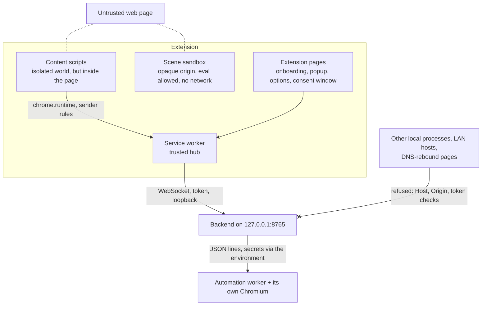

# Security

## Reporting a vulnerability

Please **don't open a public issue** for a security problem. Report it privately through GitHub instead: the
repository's **Security** tab > **Report a vulnerability**. Include what an attacker can do, the steps to reproduce,
and the versions involved (commit, Chrome, OS, profile). Fixes are released as soon as they're ready, and reporters
are credited unless they'd rather not be.

In scope: the extension, the backend and the automation worker in this repository. Model providers, Ollama,
browser-use and Chrome itself have their own disclosure processes.

## Security model

ClickyTabs sees the pages you visit, listens to your microphone while you hold the push-to-talk key, and can act in a
browser with a copy of your session cookies once you consent. The rest of this document lists what it defends against
and how. It is also the checklist for changes to the security-sensitive parts (handshake, sender rules, consent,
cookie scope, the click gate, the scene sandbox, logging).

## Assets

- The **pairing token** (grants full control of the backend session).
- **Session cookies and localStorage** exported for browser tasks.
- **Page content and screenshots** sent to the backend and, depending on the profile, to paid model APIs.
- **API keys** for paid providers (`backend/.env`).
- The user's **microphone**.

## Trust boundaries

## Threats and mitigations

| Threat | Mitigations |
|---|---|
| **Malicious web page** talks to the backend directly | Backend requires a **pairing token**, an **Origin** of `chrome-extension://<allowed id>`, and an **extension ID** in `hello` that matches the Origin. Pages can't forge the Origin header. Content scripts never contact the backend; a unit test fails if a content-script module opens a WebSocket or fetches the backend. |
| **DNS rebinding** (an attacker's domain resolves to 127.0.0.1) | `TrustedHostMiddleware` rejects any `Host` not in `trusted_hosts` (default `127.0.0.1`, `localhost`). The Origin check rejects the upgrade as well. |
| **LAN clients** | The backend binds to `127.0.0.1` by default. In Docker it listens inside the container but compose publishes it on the host's `127.0.0.1` only; remote use goes through the `remote` profile's Caddy (TLS, automatic certificates), with the domain added to `trusted_hosts`. The extension refuses to send the token over a non-loopback `ws://` URL. |
| **Another extension or local process** impersonating ClickyTabs | The extension ID is pinned by a committed public key (`manifest.key`) and allow-listed in `allowed_extension_ids`. Another extension has a different ID and Origin. A local non-browser process can set any Origin, so the **token** is the real secret: it is random (`secrets.token_urlsafe(32)`), compared in constant time, stored with owner-only permissions where the OS supports it, and rotatable (`clicky token rotate`). A running backend notices a rotated token within 2 s, redacts it from logs, and closes every session made with the old one with 4401 (the extension then asks to be re-paired). |
| **Compromised or buggy content script** reads secrets or redirects the backend | `chrome.storage.local.setAccessLevel('TRUSTED_CONTEXTS')` at SW start, so content scripts can't read the token, backend URL or consent grants. Content scripts get data only through SW messages. **Sender rules**: `sender.id` must be ours; page data and consent only from frameId 0 of the turn's tab; hotkey frames may send only `ptt.*`; settings only from extension pages. The backend URL must be `ws(s)://`. |
| **Prompt injection from page text** | Page text and DOM names are fenced in `<page_context>` with fence-closing text defanged, and the system prompt says the block is untrusted data, never instructions. Before the defang, page text is NFKC-normalized and stripped of invisible format characters, and the pattern also catches `&lt;` / numeric entities and spaced or hyphenated spellings, so zero-width, full-width or entity-encoded copies of the tag can't close the block early (10 disguises tested). Directives are validated against the page (no invented element ids, no off-screen coordinates, at most 8 per reply) and only draw on screen; anything with side effects goes through `<task>` and **consent**. The model writes only the goal and at most a start URL: the **sites are worked out by the service worker** from the URL Chrome reports for the turn's tab and from the start URL (tldts, Public Suffix List with private domains), so the cookie scope is always the **tab's registrable domain**, never the model's. The backend rejects a start URL that isn't on an approved site and drops any cookie or origin outside the tab's site again. The agent's browser can navigate only to the approved sites (browser-use `allowed_domains`, shaped so `site.evil.com` can't pass a prefix match). Cross-site tasks always ask and can never be granted "Always". Irreversible steps pause for `task.confirm.request`: the agent is told to call `ask_user`, and because small local models don't reliably do so, **every click is also gated in code** - a click on an element whose label reads like an irreversible action (place order, pay, buy, send, delete, book, ...) waits for the user's OK; coordinate clicks are kept off and the `evaluate` action is removed so a click can't bypass the label check; no answer in 2 minutes is "no". **Enter submits too** and is gated the same way: `send_keys` with Enter (also Control+Enter) and typed text with a line break (browser-use sends it as an Enter key press) ask first when the field's form has a submit button labelled like an irreversible action, or when the field is a message / reply / comment box outside a form; if the gate can't read the field, it asks. |
| **Clickjacking the consent UI** | Consent is shown in an **extension popup window** (`chrome.windows.create({type:'popup'})`), not in the page. Its buttons need `isTrusted` clicks and arm after **1.5 s**. The window shows the goal verbatim, the tab's site, the other site for a cross-site task, and whether the login is shared with its cookie count. Only that window may answer: the SW checks the sender is `consent.html` in the window it opened for that task. Closing it, or 2.5 minutes without an answer, is "no". "Always" grants live in `storage.local` (trusted contexts only), cover only same-site tasks asking for no more access than granted, and are listed and revocable in the options. They lapse 90 days after their last use, are capped at 50 sites (least recently used dropped), are all forgotten when the extension is paired with a different backend URL, and the options page shows when each was given and last used and can forget all at once. The tracker's Approve / Stop / Open buttons are in the closed shadow root, take only trusted clicks, and the SW accepts them only from the tab that owns the task; "Open in my tab" only opens a URL on the task's sites. |
| **Malicious scene code** (model-generated; page text can steer the brief) | Runs in a **sandbox page** with CSP `default-src 'none'; connect-src 'none'; worker-src blob:` (no fetch/XHR/WebSocket). The page is web accessible only via a **dynamic URL**. The **nonce + MessagePort handshake** with `event.source` checks stops other pages from driving an embedded sandbox. No conversation data, page content or tokens enter the sandbox: only the scene code. three/canvas code runs in a **blob: Worker on an OffscreenCanvas**: no DOM, so it can't navigate the frame, draw outside its canvas or phish in the page; the CSP is inherited (a no-cors fetch to a reachable server is blocked, tested). A Worker that stops sending heartbeats for 4 s (endless loop) is **terminated**; setup is capped at 10 s. Runtime messages carry a **random token** the scene code never sees, so it can't fake its own success. svg/html scenes are **sanitized by allowlist**: no scripts, event handlers, links, forms, frames, `meta`/`base`, `foreignObject`, animations of `href`, or outside references; inline handlers would be blocked by the CSP anyway. The `window`/`document` the scene code sees are plain stand-in objects inside the Worker (sizes, no-op elements, canvases), not a DOM. The stage is labelled "AI-generated". |
| **Leaked cookies or tokens** | Cookies are only collected after consent, only for the tab's registrable domain (plus its partitioned CHIPS cookies) and the tab origin's localStorage, sent over the loopback socket, and used in an **ephemeral browser profile** deleted after the task. browser-use keeps the storage state in memory and never writes it to a file. It also **prints the whole storage state, cookie values included, in a warning** when the profile path has no "tmp" in it: the profile directory is named so it can't trigger, and a log filter in the worker drops storage-state dumps and masks cookie values in every record (a test keeps it that way). The worker's environment has inherited secrets removed (other API keys, the pairing token) and gets only its own model's key; browser-use telemetry, cloud sync, the PyPI version check and extension downloads are switched off. API keys reach the worker only via its environment, never over IPC or argv. A **log redaction filter** on the root and uvicorn handlers masks the pairing token and API-key patterns (e.g. `sk-ant-…`); the worker's own log (`.clicky/logs/worker.log`, rotated at 2 MB x 3) goes through the same filter, and the agent's task summary (it describes the user's account: orders, names) is logged at DEBUG only. `.env`, `clicky.toml`, `.clicky/` and `*.pem` are git-ignored. Capability details are only sent after authentication; `/v1/info` is minimal. |
| **Runaway headed browser** | One worker process per task, inside a **Windows Job Object with kill-on-close**, so Chromium with session cookies can't outlive the backend; closing the session or starting a new conversation kills it. `allowed_domains` pins navigation. Task limits (`max_steps`, a step timeout, 30 minutes per task) and `task.cancel` stop it. The agent can't search the web, upload local files or print to PDF (those actions are removed). |
| **Runtime configuration over the socket** | The options page can switch the profile and one provider (model, voice) per capability without a restart. Only extension pages may ask (sender rule `extension-page`); the backend accepts only a provider from the catalog, a model, and `voice` / `voice_id` / `effort` / `speed`: base URLs, hosts and keys stay in `clicky.toml` / `.env`, so the socket can never point a provider (and the API key it sends) at another server. Each choice is validated by the adapter's options model before anything changes; test providers are refused outside the fake profile; `CLICKY_PROFILE` pins the profile against the page. The choices are saved to `.clicky/ui-settings.json` (owner-only) only once they applied. |
| **Service worker or offscreen document stopped mid-turn** (MV3 can stop either at any time) | The offscreen document keeps a lifeline port to the worker: when the worker dies, the document cancels the recording (the mic indicator goes off) and stops playback, then reconnects, which starts a new worker at once; the recorder also stops itself after 65 s; a recording chunk for a turn the worker doesn't know is refused and stops the recorder. When the document dies, the worker ends the turn it was recording with a message and tells the tab its speech stopped. A new worker tells every tab it started, so a turn in flight ends with "the connection was interrupted" and a running task's tracker says it was stopped (the backend stops a session's task and its browser when the session ends). The 30 s alarm also runs while connected, as a watchdog. |
| **The Docker image** | Built from `backend/` with a `.dockerignore` that keeps `.env`, `clicky.toml`, `.clicky/` (token, models), virtualenvs and tests out; API keys reach the container through compose's `env_file` at run time, never the image. Runs as an unprivileged user (uid 10001); everything it writes goes to the `/data` volume. Ollama has no published port. Inside the container the agent's Chromium runs without its own sandbox (browser-use's Docker flags), so the container is the boundary for a hostile page. |
| **Hostile page vs. the injected UI** (CSS resets, CSP, Trusted Types, focus or click handlers) | Closed shadow root; WXT `:host{all:initial !important}` overrides page `!important` rules on the host; the layer is a top-layer popover re-promoted above later dialogs, popovers and fullscreen. Inline styles go through CSSOM, so strict `style-src` doesn't apply. Keys are isolated and pointer events stop at the shadow root. If the page forbids Trusted Types policies, `trusted-types-guard.ts` hides the factory **from the extension's isolated world only**; the page's own Trusted Types enforcement is untouched. An e2e fixture page covers all of this. |
| **Page script driving HUD turns** | Turns start only from the companion's top-frame content script (`turn.text`, sender rule `top-frame`), are bounded to 4000 characters, and get worker-assigned ids; events go back only to the tab that started the turn. Page scripts can't call `chrome.runtime` as the extension. |
| **Page context leaking what the user typed or secrets in URLs** | Input, select and textarea values and editable content are never read; fields are named by labels, placeholders or ARIA only; the selection is skipped while a field has focus. Every visible text field is masked in the screenshot. The URL loses its fragment and secret-looking query values (`token`, `code`, `session`, `key`, …). The backend bounds every field of a page (sizes, counts, id pattern, states) and fences the page as untrusted data in the prompt. |
| **Microphone left open or abused** | The offscreen recorder opens the mic when push-to-talk starts and releases every track the moment recording stops (Chrome's indicator goes off); a release that arrives while the mic is still opening is honoured. Audio goes only to the backend's current voice turn: chunks are ≤ 1 MB each, ≤ 8 MB per turn, chunks for other turns are ignored, and a turn whose audio stops arriving ends after 75 s. Silence is detected locally and never sent to an STT model. |
| **Stuck microphone** | The SW owns PTT state and releases on keyup, blur, hidden, pagehide, tab switch, window blur and after a 60 s maximum hold; a `REC` badge shows while recording. |

## Known limits

- **Device Bound Session Credentials (Chrome 145+)** and IP or user-agent checks can invalidate exported sessions
  (Google first). Tasks on such sites may fail to start signed in; the UI reports this clearly. UA and locale parity
  reduce, but don't remove, the problem.
- Cookies the agent sets in its ephemeral profile are not synced back to your browser.
- The screenshot shows what is on screen. Text fields are masked, but anything else visible (messages, documents,
  account details, rich editors such as Notion's) is included. Page context is only collected when you ask something.
- Anything the backend sends to a paid API (screenshots, page text) is subject to that vendor's data policy. Use the
  `local` profile to keep everything on your machine.
- Running the backend on another machine without TLS exposes the token and page data on the network. Don't: use the
  compose `remote` profile (Caddy) or another TLS proxy.
- In Docker, the browser-task Chromium has no sandbox of its own (the container is the boundary). Run tasks on
  sites you trust, or run the backend from source on Windows/macOS, where Chromium keeps its sandbox.
- The backend accepts only the extension ID pinned by `extension/keys/dev-public-key.b64`. An extension you package
  with another key (and so another ID) must be added to `allowed_extension_ids` (or `CLICKY_ALLOWED_EXTENSION_IDS`).

## Operational guidance

- Rotate the token with `uv run clicky token rotate` (Docker: `docker compose exec backend clicky token rotate`) if it
  may have leaked. A running backend applies it within 2 s and disconnects the extension; re-pair it.
- Keep `allowed_extension_ids` to the IDs you actually use.
- Don't add hosts to `trusted_hosts` unless you put the backend behind a TLS reverse proxy.
- Never paste API keys into issues or logs; `clicky config show` prints whether a key is set, not its value.
